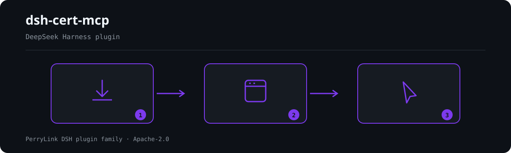

# dsh-cert-mcp

[](LICENSE)
[](https://github.com/topics/dsh-plugin)
[](https://dsh.market/)
[](https://gitee.com/perrylink/dsh-cert-mcp)
[](https://github.com/PerryLink/dsh-cert-mcp/releases)
[](https://www.npmjs.com/package/dsh-cert-mcp)
[](https://www.npmjs.com/package/dsh-cert-mcp)
[](https://dshfind.com/zh/plugins/PerryLink/dsh-cert-mcp?ref=badge)
[](https://glama.ai/mcp/servers/PerryLink/dsh-cert-mcp)
[](https://glama.ai/mcp/servers/PerryLink/dsh-cert-mcp)

[English](README.md) · [简体中文](README-zh.md) · [Español](README-es.md) · [Português](README-pt.md) · [हिन्दी](README-hi.md)

```sh
dsh plugin --profile <name> add dsh-cert-mcp
```


只读 [MCP](https://modelcontextprotocol.io) 服务器，对外暴露 [dsh-plugin-certification](https://github.com/PerryLink/dsh-plugin-certification) 注册表：DeepSeek Harness（DSH）插件的认证等级、快照日期与五维证据。零运行时依赖，stdio 传输。

## 安装

```sh
dsh plugin --profile web add github:PerryLink/dsh-cert-mcp
```

```sh
git clone https://github.com/PerryLink/dsh-cert-mcp
cd dsh-cert-mcp
node src/index.js        # stdio 服务器
```

也可以直接从已发布的 npm 包运行：`npx dsh-cert-mcp`。

### 在 MCP 客户端中注册

Claude Code：

```sh
claude mcp add dsh-cert -- node <path-to-repo>/src/index.js
```

Claude Desktop（`claude_desktop_config.json`）：

```json
{
  "mcpServers": {
    "dsh-cert": {
      "command": "node",
      "args": ["<path-to-repo>/src/index.js"]
    }
  }
}
```

DSH：通过 [dsh-mcp-panel](https://github.com/PerryLink/dsh-mcp-panel) 以 stdio 服务器方式添加，或使用任何支持 `stdio` 的 MCP 客户端。

### 作为 DSH bundle 安装

本包声明了 `dsh.bundle.patch` → `cordis.patch.yml`，因此也可作为 DeepSeek Harness bundle 安装：

```sh
# git 通道（main 最新）
dsh plugin --profile web add github:PerryLink/dsh-cert-mcp

# npm 通道（已发布版本）
dsh plugin --profile web add dsh-cert-mcp
```

插入的 row 通过标准 Cordis 插件契约加载本包：host 半边是普通 ESM 模块，具名导出 `name`、`inject` 与 `apply(ctx)`。本包不含浏览器 UI，因此没有 `dsh.client` 声明。

```js
// bundle 入口（host 半边）—— patch row 加载的契约
export const name = 'dsh-cert-mcp'
export const inject = ['tools'] // 宿主工具面，由 dsh-tools 提供
export function apply(ctx) {
  // 注册只读认证查询面
  // （get_certification / list_certified / certification_spec）
}
```

**host 半边需要 `tools` 服务**（由 `@deepseek-ai/dsh-tools` 提供）。缺少该服务的 profile 不会静默丢失工具：Cordis 会把这个 row 停在 `PENDING`，在 profile 的插件列表里看得见。除此之外不需要任何东西——没有配置键、没有凭据，加载期也不联网。

**两个半边，同一条数据路径。** bundle row 与 stdio 服务器是同一份 `handleRequest` 核心的两个入口。server 半边是独立进程，任何 MCP 客户端都能拉起（`node src/index.js`），它**不在插件路径上**：安装本 bundle 不会启动它，卸载本 bundle 也不会碰它；反过来 `npx dsh-cert-mcp` 不会在 DSH 工具面上注册任何东西。

卸载：`dsh plugin --profile web remove dsh-cert-mcp`（或从 profile patch 里删掉该 row）。上面的独立 stdio MCP 服务器对任何 MCP 客户端照旧可用。

## What is dsh-cert-mcp?

只读 [MCP](https://modelcontextprotocol.io) 服务器，对外暴露 [dsh-plugin-certification](https://github.com/PerryLink/dsh-plugin-certification) 注册表：DeepSeek Harness（DSH）插件的认证等级、快照日期与五维证据。零运行时依赖，stdio 传输。



*工作流概览：安装 → 打开面板 → 操作。下面的示例使用实际命令面。*


*同一次运行，动图版。*

## 工具

| 工具 | 输入 | 返回 |
|---|---|---|
| `get_certification` | `owner`、`repo` | 完整认证记录（等级、快照、五个维度、否决项、备注）或「无记录」 |
| `list_certified` | — | 公开注册表的全部条目：仓库 / 等级 / 快照 |
| `certification_spec` | — | 规范 v1 摘要：五个维度、等级刻度、否决规则 |

内嵌快照位于 `data/certified.json`（由认证仓同步而来），服务器最多每五分钟从公开注册表刷新一次。不写入、不涉及密钥、不执行代码。

## 为什么需要它

DeepSeek Harness 官方仓不运营插件注册表，也不接受外部 PR；发现渠道是 `dsh-plugin` GitHub topic 与社区列表，而它们都不做认证。`dsh-plugin-certification` 把「这个插件我能不能装」变成可复现的五维检查（清单、构建卫生、供应链 Scorecard、发布溯源、沙箱安装冒烟），并给出公开注册表与 README 徽章。本 MCP 服务器是同一份数据的 agent 界面：agent 在推荐或安装某个插件之前，可以先查它的认证记录。

## 注册表

数据源：[PerryLink/dsh-plugin-certification](https://github.com/PerryLink/dsh-plugin-certification) —— `data/certified.json`，规范 v1。

**注册表是什么，以及本服务给出简短回答意味着什么。** 注册表是一个**自愿加入的子集**：只有被评估过并留下记录的仓才会出现在里面，所以"查不到记录"**不等于**该插件未认证，`list_certified` 只返回很少几行也**不等于**被评估的插件很少。撰写本段时随包快照里只有 **1 条**（grade A，快照日 2026-09-07）；单条列表不具备统计意义 —— 一个等级只描述那一个仓，跨插件可排序的比较要等注册表积累到足够多才成立。每一次 `list_certified` 回复都带一个 `coverage` 对象把这件事说清楚，因此只读工具输出的 agent 不会把条数误当成生态覆盖率。快照日期是**认证仓的事实**，不是本服务的时效承诺：它与 `dsh-plugin-certification` 逐字节同步，进度与门禁都由那边负责。

## 兼容性

| 方面 | 状态 |
|---|---|
| Harness | DeepSeek Harness `dsh-v0.2.1-rc.2`（devDependencies 与声明的 `engines.dsh` 范围均已接纳该线；`typecheck` 与 5 项测试套件已对 `@deepseek-ai/dsh-system-prompt` / `@deepseek-ai/dsh-tools` 0.2.1-rc.2 跑绿） |
| Node | `^22.19.0 \|\| >=24.0.0` |
| 声明的宿主范围 | `engines.dsh`：`>=0.2.1-0 <0.3.0`，并带 `dsh.manifestVersion: 1` |
| peer | `@deepseek-ai/cordis` `^4.0.2`。host 半边运行时另需 `tools` 服务；stdio 半边除 Node 外什么都不需要。 |

## 开发

```sh
pnpm install
pnpm run typecheck                            # 唯一类型尺子：对已发布 host 面做 checkJs
pnpm test                                     # JSON-RPC 冒烟 + 真 Cordis 运行时套件
pnpm pack                                     # 发布用 tarball
```

运行时套件挂载**真实**的 `SystemPrompt`/`ToolRuntime` 注册表，断言：挂载本包会把三个认证工具放进 `ctx.tools.schemas()`；释放 fiber 后它们消失；缺少 `tools` 服务的上下文会让插件停在 `PENDING`。验收**刻意不用** `dsh --dump-config`：在那里，已挂载的 row 与 pending 的 fiber 看起来一模一样。

本仓**刻意只有一把类型尺子**：`@deepseek-ai/*` 经本仓自己的 `node_modules`（钉住的 devDependencies，即已发布线）解析，且本包不声明任何 DSH peer，因此第二份 `tsc` 配置只会是量同一类型宇宙的同一条命令。`typecheck:ci` 脚本作为历史 no-op 副本保留（它唯一的额外键是空 `paths: {}`），只为兼容既有引用，不是第二个类型面。独立的第二份证据是上面的运行时挂载门。

## PerryLink DSH Plugin Family

本项目是 [PerryLink](https://github.com/PerryLink) 维护的 DeepSeek Harness 插件家族成员。完整名单默认折叠，避免每个 README 的首屏被长表淹没；点击展开可查看每一行及其状态。

<details>
<summary>展开全部插件</summary>

| 插件 | 状态 |
|---|---|
| **[dsh-aqua-input-check](https://github.com/PerryLink/dsh-aqua-input-check)** |  |
| **[dsh-archive-check](https://github.com/PerryLink/dsh-archive-check)** |  |
| **[dsh-auto-review](https://github.com/PerryLink/dsh-auto-review)** |  |
| **[dsh-autotier](https://github.com/PerryLink/dsh-autotier)** |  |
| **[dsh-bid-ca-precheck](https://github.com/PerryLink/dsh-bid-ca-precheck)** |  |
| **[dsh-bid-qual-check](https://github.com/PerryLink/dsh-bid-qual-check)** |  |
| **[dsh-cert-mcp](https://github.com/PerryLink/dsh-cert-mcp)** |  |
| **[dsh-checkpoint-rewind](https://github.com/PerryLink/dsh-checkpoint-rewind)** |  |
| **[dsh-click](https://github.com/PerryLink/dsh-click)** |  |
| **[dsh-composer-history](https://github.com/PerryLink/dsh-composer-history)** |  |
| **[dsh-contract-stance](https://github.com/PerryLink/dsh-contract-stance)** |  |
| **[dsh-customs-doc-check](https://github.com/PerryLink/dsh-customs-doc-check)** |  |
| **[dsh-data-quality](https://github.com/PerryLink/dsh-data-quality)** |  |
| **[dsh-demurrage-ledger](https://github.com/PerryLink/dsh-demurrage-ledger)** |  |
| **[dsh-doublecheck](https://github.com/PerryLink/dsh-doublecheck)** |  |
| **[dsh-drill-script-check](https://github.com/PerryLink/dsh-drill-script-check)** |  |
| **[dsh-eia-guide-check](https://github.com/PerryLink/dsh-eia-guide-check)** |  |
| **[dsh-emergency-plan](https://github.com/PerryLink/dsh-emergency-plan)** |  |
| **[dsh-essay-rubric-check](https://github.com/PerryLink/dsh-essay-rubric-check)** |  |
| **[dsh-evidence-check](https://github.com/PerryLink/dsh-evidence-check)** |  |
| **[dsh-export-ctl-check](https://github.com/PerryLink/dsh-export-ctl-check)** |  |
| **[dsh-fast](https://github.com/PerryLink/dsh-fast)** |  |
| **[dsh-fmea-table-check](https://github.com/PerryLink/dsh-fmea-table-check)** |  |
| **[dsh-forecast-penalty](https://github.com/PerryLink/dsh-forecast-penalty)** |  |
| **[dsh-fund-research](https://github.com/PerryLink/dsh-fund-research)** |  |
| **[dsh-github](https://github.com/PerryLink/dsh-github)** |  |
| **[dsh-gongwen-flow-check](https://github.com/PerryLink/dsh-gongwen-flow-check)** |  |
| **[dsh-gongwen-word-check](https://github.com/PerryLink/dsh-gongwen-word-check)** |  |
| **[dsh-guard-plan-qc](https://github.com/PerryLink/dsh-guard-plan-qc)** |  |
| **[dsh-hazchem-check](https://github.com/PerryLink/dsh-hazchem-check)** |  |
| **[dsh-hazplan-check](https://github.com/PerryLink/dsh-hazplan-check)** |  |
| **[dsh-hidden-risk-map](https://github.com/PerryLink/dsh-hidden-risk-map)** |  |
| **[dsh-hs-classify](https://github.com/PerryLink/dsh-hs-classify)** |  |
| **[dsh-icd-rule-check](https://github.com/PerryLink/dsh-icd-rule-check)** |  |
| **[dsh-industry-research](https://github.com/PerryLink/dsh-industry-research)** |  |
| **[dsh-lawcite-adapter](https://github.com/PerryLink/dsh-lawcite-adapter)** |  |
| **[dsh-laya](https://github.com/PerryLink/dsh-laya)** |  |
| **[dsh-lc-doc-check](https://github.com/PerryLink/dsh-lc-doc-check)** |  |
| **[dsh-learning-gap-check](https://github.com/PerryLink/dsh-learning-gap-check)** |  |
| **[dsh-library](https://github.com/PerryLink/dsh-library)** |  |
| **[dsh-local-ai](https://github.com/PerryLink/dsh-local-ai)** |  |
| **[dsh-lsp-actions](https://github.com/PerryLink/dsh-lsp-actions)** |  |
| **[dsh-mask](https://github.com/PerryLink/dsh-mask)** |  |
| **[dsh-mcp-panel](https://github.com/PerryLink/dsh-mcp-panel)** |  |
| **[dsh-medrec-qc](https://github.com/PerryLink/dsh-medrec-qc)** |  |
| **[dsh-memento](https://github.com/PerryLink/dsh-memento)** |  |
| **[dsh-nsfc-form-check](https://github.com/PerryLink/dsh-nsfc-form-check)** |  |
| **[dsh-nurse-record-check](https://github.com/PerryLink/dsh-nurse-record-check)** |  |
| **[dsh-observe](https://github.com/PerryLink/dsh-observe)** |  |
| **[dsh-origin-rvc-check](https://github.com/PerryLink/dsh-origin-rvc-check)** |  |
| **[dsh-ota-review-check](https://github.com/PerryLink/dsh-ota-review-check)** |  |
| **[dsh-output-styles](https://github.com/PerryLink/dsh-output-styles)** |  |
| **[dsh-paper-doc-adapter](https://github.com/PerryLink/dsh-paper-doc-adapter)** |  |
| **[dsh-permission-rules](https://github.com/PerryLink/dsh-permission-rules)** |  |
| **[dsh-permit-report-check](https://github.com/PerryLink/dsh-permit-report-check)** |  |
| **[dsh-pipeline-check](https://github.com/PerryLink/dsh-pipeline-check)** |  |
| **[dsh-pleading-draft](https://github.com/PerryLink/dsh-pleading-draft)** |  |
| **[dsh-plugin-doctor](https://github.com/PerryLink/dsh-plugin-doctor)** |  |
| **[dsh-plugin-guide](https://github.com/PerryLink/dsh-plugin-guide)** |  |
| **[dsh-plugin-kit](https://github.com/PerryLink/dsh-plugin-kit)** |  |
| **[dsh-plugin-upgrade](https://github.com/PerryLink/dsh-plugin-upgrade)** |  |
| **[dsh-policy-brief-draft](https://github.com/PerryLink/dsh-policy-brief-draft)** |  |
| **[dsh-power-loss-split](https://github.com/PerryLink/dsh-power-loss-split)** |  |
| **[dsh-power-ticket-check](https://github.com/PerryLink/dsh-power-ticket-check)** |  |
| **[dsh-ppap-check](https://github.com/PerryLink/dsh-ppap-check)** |  |
| **[dsh-protest-deadline](https://github.com/PerryLink/dsh-protest-deadline)** |  |
| **[dsh-railway-window](https://github.com/PerryLink/dsh-railway-window)** |  |
| **[dsh-repair-order-qc](https://github.com/PerryLink/dsh-repair-order-qc)** |  |
| **[dsh-research-report](https://github.com/PerryLink/dsh-research-report)** |  |
| **[dsh-review-reply-check](https://github.com/PerryLink/dsh-review-reply-check)** |  |
| **[dsh-rulefile-check](https://github.com/PerryLink/dsh-rulefile-check)** |  |
| **[dsh-safety-brief-check](https://github.com/PerryLink/dsh-safety-brief-check)** |  |
| **[dsh-score](https://github.com/PerryLink/dsh-score)** |  |
| **[dsh-session-sync](https://github.com/PerryLink/dsh-session-sync)** |  |
| **[dsh-site-log-check](https://github.com/PerryLink/dsh-site-log-check)** |  |
| **[dsh-skill-pack-security](https://github.com/PerryLink/dsh-skill-pack-security)** |  |
| **[dsh-soe-decision-check](https://github.com/PerryLink/dsh-soe-decision-check)** |  |
| **[dsh-soilwater-check](https://github.com/PerryLink/dsh-soilwater-check)** |  |
| **[dsh-sop-sync-check](https://github.com/PerryLink/dsh-sop-sync-check)** |  |
| **[dsh-spc-gbt-adapter](https://github.com/PerryLink/dsh-spc-gbt-adapter)** |  |
| **[dsh-talk](https://github.com/PerryLink/dsh-talk)** |  |
| **[dsh-tender-extract](https://github.com/PerryLink/dsh-tender-extract)** |  |
| **[dsh-tender-matrix](https://github.com/PerryLink/dsh-tender-matrix)** |  |
| **[dsh-test-drive](https://github.com/PerryLink/dsh-test-drive)** |  |
| **[dsh-ticktick](https://github.com/PerryLink/dsh-ticktick)** |  |
| **[dsh-translate](https://github.com/PerryLink/dsh-translate)** |  |
| **[dsh-warranty-calc](https://github.com/PerryLink/dsh-warranty-calc)** |  |
| **[dsh-budget](https://github.com/PerryLink/dsh-budget)** | 🧊 已冻结 — 见仓库 README |
| **[dsh-claude-move](https://github.com/PerryLink/dsh-claude-move)** | 🧊 已冻结 — 见仓库 README |
| **[dsh-defend](https://github.com/PerryLink/dsh-defend)** | 🧊 已冻结 — 见仓库 README |
| **[dsh-draw](https://github.com/PerryLink/dsh-draw)** | 🧊 已冻结 — 见仓库 README |
| **[dsh-reach](https://github.com/PerryLink/dsh-reach)** | 🧊 已冻结 — 见仓库 README |
| **[dsh-background-agents](https://github.com/PerryLink/dsh-background-agents)** | 🚫 已退役 — 见仓库 README |
| **[dsh-session-pin](https://github.com/PerryLink/dsh-session-pin)** | 🚫 已退役 — 见仓库 README |
| **[dsh-team-rooms](https://github.com/PerryLink/dsh-team-rooms)** | 🚫 已退役 — 见仓库 README |

</details>

## 许可证

Apache-2.0。列表或等级是证据记录，不是安全保证：插件以你的权限运行在你的 DSH 进程内。

### 示例

以下为插件真实入口；安装后调用一个即可。

#### 详细示例

**命令**

~~~sh
get_certification
~~~

**输入**

~~~json
{
  "owner": "PerryLink",
  "repo": "dsh-auto-review"
}
~~~

**输出**

~~~text
{
  "repo": "PerryLink/dsh-auto-review",
  "grade": "A",
  "snapshot": "2026-09-07",
  "dimensions": {
    "manifest": { "result": "pass" },
    "buildHygiene": { "result": "pass" },
    "supplyChain": { "result": "pass", "score": 5.4 },
    "releaseIntegrity": { "result": "pass" },
    "installSmoke": { "result": "ok" }
  },
  "veto": null
}
~~~

*来源 `plugins/dsh-cert-mcp/src/server.js:192-199; data in plugins/dsh-cert-mcp/data/certified.json:1-30; smoke test at plugins/dsh-cert-mcp/test/smoke.mjs:29-39`*

#### 失败分支

**输入**

~~~text
{"owner":"nobody","repo":"nothing"}
~~~

**输出**

~~~text
No certification record for nobody/nothing in registry snapshot 2026-09-07.
~~~

*来源 `plugins/dsh-cert-mcp/src/server.js:191-199; plugins/dsh-cert-mcp/test/smoke.mjs:41-47; plugins/dsh-cert-mcp/data/certified.json`*

#### 简短示例

- `list_certified`
- `certification_spec`

