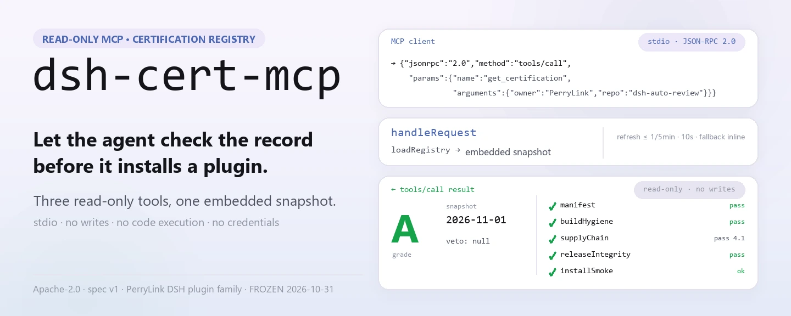
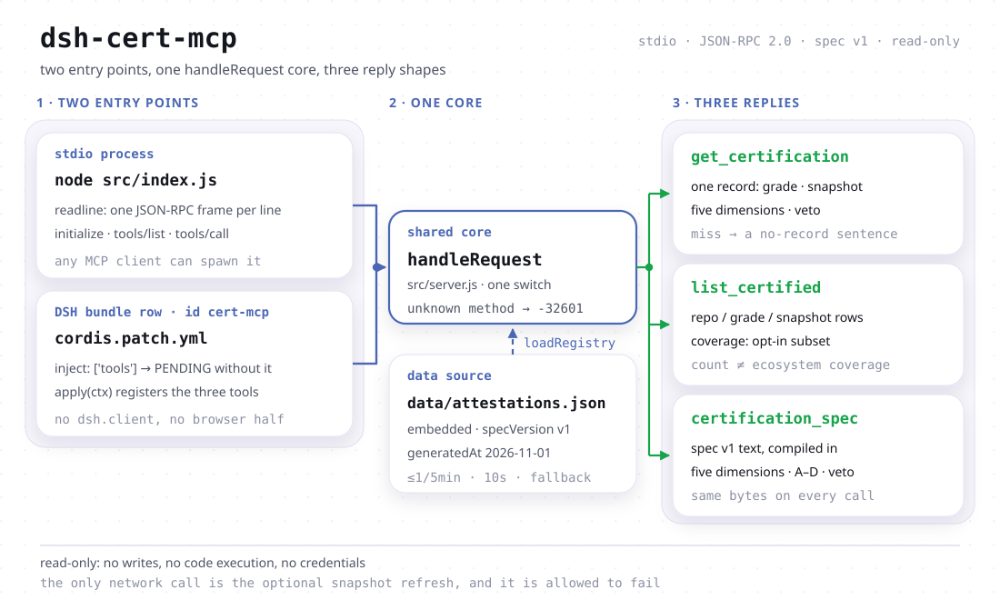

<div align="center">

<picture>
  <source media="(prefers-color-scheme: dark)" srcset="docs/assets/dsh-cert-mcp-hero-en-dark.webp">
  
</picture>

# dsh-cert-mcp

**A read-only MCP endpoint that hands DSH plugin certification grades, snapshot dates and five-dimension evidence to an agent.**

Before recommending or installing a plugin, an agent can look up its certification record: the letter grade, the date it was measured, the five dimension results and whether a veto fired. Three read-only tools, one embedded snapshot, stdio transport — no writes, no code execution, no credentials.

[Install](#quick-start) · [Tools](#capabilities) · [Registry](#data-and-coverage) · [FAQ](#faq) · [简体中文](README.md) · [English](README.en.md) · [Español](README.es.md) · [Português](README.pt.md) · [हिन्दी](README.hi.md)

[](LICENSE)
[](#compatibility)
[](https://www.npmjs.com/package/dsh-cert-mcp)
[](https://github.com/PerryLink/dsh-cert-mcp/actions/workflows/smoke.yml)
[](#compatibility)

[](https://github.com/PerryLink/dsh-cert-mcp/stargazers)
[](https://www.npmjs.com/package/dsh-cert-mcp)
[](https://dshfind.com/en/plugins/PerryLink/dsh-cert-mcp?ref=badge)
[](https://dsh.market/)
[](https://gitee.com/perrylink/dsh-cert-mcp)

```sh
dsh plugin --profile <name> add dsh-cert-mcp
```

</div>

<sub>Community plugin, not affiliated with DeepSeek. Canonical repository: <https://github.com/PerryLink/dsh-cert-mcp> (Gitee is a mirror). Maintenance status: 🧊 FROZEN since 2026-10-31 — reference integration only.</sub>

## What it is

A read-only MCP server: it exposes the `dsh-plugin-certification` registry as three tools an agent can call — one record's grade, snapshot date and five-dimension evidence; every row in the registry plus a coverage statement; and spec v1 itself. Zero runtime dependencies, newline-delimited JSON-RPC on stdin/stdout, so any MCP client that speaks stdio can spawn it. The same `handleRequest` core is reused by the DSH bundle half, so installing the bundle puts the three tools straight onto the DSH tool surface.

What it deliberately does not do: it writes nothing, executes nothing, needs no credentials, and does not decide whether a plugin is worth installing. A missing record does **not** mean a plugin is uncertified (the registry is an opt-in subset), and an A grade is **not** a security guarantee (a grade is an evidence record; plugins run inside your DSH process with your permissions).

<picture>
  <source media="(prefers-color-scheme: dark)" srcset="docs/assets/dsh-cert-mcp-flow-v5-dark.svg">
  
</picture>

## Quick start

### 1. Install (three channels)

```sh
dsh plugin --profile web add dsh-cert-mcp                   # npm channel (published)
dsh plugin --profile web add github:PerryLink/dsh-cert-mcp  # git channel (latest main)
npx dsh-cert-mcp                                            # or run it as a plain stdio server
```

The package declares `dsh.bundle.patch` → `cordis.patch.yml`, so installing it inserts one bundle row (`id: cert-mcp`). You can also use it as a plain MCP server: `node src/index.js` or `npx dsh-cert-mcp`. Neither path starts the other (see “two halves”).

### 2. Register it in an MCP client

Claude Code:

```sh
claude mcp add dsh-cert -- node <path-to-repo>/src/index.js
```

Claude Desktop (`claude_desktop_config.json`):

```json
{
  "mcpServers": {
    "dsh-cert": {
      "command": "node",
      "args": ["<path-to-repo>/src/index.js"]
    }
  }
}
```

DSH: add it through [dsh-mcp-panel](https://github.com/PerryLink/dsh-mcp-panel) as a stdio server, or install the bundle from the step above.

### 3. Verify

```sh
printf '%s\n' '{"jsonrpc":"2.0","id":1,"method":"initialize","params":{}}' | node src/index.js
```

It answers with one line:

```text
{"jsonrpc":"2.0","id":1,"result":{"protocolVersion":"2024-11-05","capabilities":{"tools":{}},"serverInfo":{"name":"dsh-cert-mcp","version":"0.2.13"}}}
```

A `tools/list` call then returns the three tools.

*Observed from `src/server.js:165-176` (the initialize reply) and `src/index.js:9-23` (line-delimited stdio); the version comes from `package.json`.*

## Capabilities

### The three tools

| Tool | Input | Returns | Use it when |
|---|---|---|---|
| `get_certification` | `owner`, `repo` (case-insensitive) | the full record JSON: `grade`, `snapshot`, `specVersion`, the five dimensions, `veto`, `notes`, `selfAssessed`, `assessor` | you know which plugin you mean and want its grade or the evidence behind it |
| `list_certified` | none | `specVersion`, `generatedAt`, `count`, `coverage`, `entries[]` (repo / grade / snapshot) | you want to see what the registry holds, or compare across plugins |
| `certification_spec` | none | spec v1 in full: the five dimensions A–E, the grade scale, the veto rule, the evidence discipline | you read a grade and want to know what it actually means |

All three declare the MCP read-only annotations (`readOnlyHint: true` / `destructiveHint: false` / `idempotentHint: true` / `openWorldHint: false`), and repeated calls with the same arguments return the same record. Every `tools/call` goes through `loadRegistry` first: inside the five-minute window it uses the current snapshot, otherwise it tries the public registry once, waits at most ten seconds, and keeps the embedded snapshot if that fails.

### Two halves, one data path

The bundle row and the stdio server are two entry points over one `handleRequest` core:

- **The server half** (`src/index.js`, bin name `dsh-cert-mcp`) is an independent process any MCP client can spawn. It is **not** on the plugin path: installing the bundle never starts it, and removing the bundle never touches it.
- **The bundle half** (`src/plugin.js`) is loaded by the row in `cordis.patch.yml`, declares `inject = ['tools']`, and puts the three tools on the DSH tool surface. Conversely, `npx dsh-cert-mcp` registers nothing on the DSH tool surface.

```js
// src/plugin.js — the contract the patch row loads
export const name = 'dsh-cert-mcp'
export const inject = ['tools'] // the host tool surface, provided by dsh-tools
export function apply(ctx) {
  // registers the three read-only tools on ctx.tools, 1:1
}
```

`tools` is a hard dependency: a profile without that service does not silently lose the tools — Cordis parks the row in `PENDING`, which is visible in the profile's plugin list. Nothing else is required: no config keys, no credentials, and no network access at load time. This package ships no browser UI, so there is no `dsh.client` declaration.

### Examples: real calls

#### Detailed example

**Call**

~~~text
get_certification
~~~

**Input**

~~~json
{ "owner": "PerryLink", "repo": "dsh-auto-review" }
~~~

**Output**(`dimensions.*.evidence` is shortened to `…` for width; every other field is verbatim from the snapshot)

```json
{
  "repo": "PerryLink/dsh-auto-review",
  "grade": "A",
  "specVersion": "v1",
  "snapshot": "2026-11-01",
  "dimensions": {
    "manifest": { "result": "pass", "evidence": "…" },
    "buildHygiene": { "result": "pass", "evidence": "…" },
    "supplyChain": { "result": "pass", "score": 4.1, "evidence": "…" },
    "releaseIntegrity": { "result": "pass", "evidence": "…" },
    "installSmoke": { "result": "ok", "evidence": "…" }
  },
  "veto": null,
  "notes": "Re-audited at 0.15.0 on 2026-11-01; grade A retained. … Self-assessed: the certifier and the plugin author are the same maintainer …",
  "selfAssessed": true,
  "assessor": "PerryLink (maintainer; same party as the plugin author)"
}
```

*Observed from `src/server.js:192-199`; data from `data/attestations.json`.*

#### Failure branch

**Input**

~~~text
{"owner":"nobody","repo":"nothing"}
~~~

**Output**

~~~text
No certification record for nobody/nothing in registry snapshot 2026-11-01.
~~~

*Observed from `src/server.js:191-199`; a miss says so plainly and never guesses a grade.*

#### Brief examples

- `list_certified` → `count: 1`, `coverage.certified: 1`, plus the sentence saying the registry lists only evaluated repositories and is not a census
- `certification_spec` → spec v1 in full (five dimensions A–E, grades A–D, the veto rule, the evidence discipline)

## Data and coverage

The registry is an **opt-in subset** of `dsh-plugin-certification`: a repository appears in it only after it has been evaluated and recorded. Four consequences:

- **No record ≠ uncertified.** A missing record says the registry does not hold that repository; it does not say the plugin was never assessed, and it certainly does not say anything is wrong with it.
- **Count ≠ ecosystem coverage.** A short `list_certified` reply is not evidence that few plugins were assessed; the registry does not record how many candidates exist, so no “N of M” denominator is offered here — that number would be invented.
- **A single-entry list carries no statistical meaning.** The bundled snapshot holds exactly one entry (`PerryLink/dsh-auto-review`, grade A, snapshot 2026-11-01, and `selfAssessed: true` — the assessor and the plugin author are the same maintainer, so this is not independent third-party certification). One grade describes that one repository; rankable comparison only becomes possible once the registry holds many.
- **The snapshot date is the certification repo's fact.** `data/attestations.json` is synced byte-for-byte from `dsh-plugin-certification` (`schema: dsh-attestation-registry/1`, `specVersion: v1`); that repository owns the schedule and the gate. This server only carries the data.

Every `list_certified` reply carries a `coverage` object (`certified` / `subset` / `scope` / `representative` / `registry` / `generatedAt`) that travels with the numbers, so an agent reading only the tool output cannot mistake the count for ecosystem coverage.

## FAQ

**Why is a plugin missing from the registry?**

The registry is an opt-in subset: it lists only repositories that were evaluated and recorded. Being absent is not a statement that a plugin is uncertified. The evaluation that puts a repository in the registry lives in `dsh-plugin-certification`, not here.

**Will this repository gain new features?**

No. It was frozen on 2026-10-31 and stays as a reference integration; the registry and the evaluation rules belong to `dsh-plugin-certification`.

**Does it need network access or credentials?**

No credentials at all. The only outbound call is the snapshot refresh (at most once per five minutes, ten-second timeout), and a failure just keeps the embedded snapshot. `initialize` and `tools/list` make no network call; all three tools go through `loadRegistry`, which stays offline while the refresh window is open.

**Do I need both the bundle and the stdio server?**

No. They are independent: the bundle only affects the DSH tool surface, the stdio server only serves MCP clients. Same core, neither starts the other.

**Does grade A mean a plugin is safe?**

No. A grade is an evidence record (manifest, build hygiene, supply-chain Scorecard, release provenance, sandboxed install smoke), not a security guarantee; plugins run inside your own process with your permissions.

**Does the snapshot date change after a refresh?**

It follows the public registry. That date is the certification repo's fact, not a freshness promise from this server.

## Known limits

- **Frozen at 2026-10-31.** No new certification features, and no change that would make this repository the registry source.
- **The bundled snapshot holds one record.** Ranking and comparison in `list_certified` have nothing to compare yet.
- **No write surface.** You cannot submit a certification, trigger a re-evaluation or edit the snapshot; updates can only come from upstream.
- **The refresh is best-effort.** A cache hit makes no network call, and a timeout or failure falls back to the embedded snapshot silently — there is no extra log line.
- **The protocol version is pinned to `2024-11-05`** and the only declared capability is `tools`; no resources or prompts.
- **No authentication.** Anyone who can run the process can read the registry (the data is public anyway).
- **A grade is not a live security scan.** `veto` appears only when the certification repo recorded one; this server never re-judges.

## Compatibility

| Surface | Status |
|---|---|
| Harness | `engines.dsh`: `>=0.2.1-0 <0.3.0 \|\| >=0.2.2-0 <0.3.0`; development and tests run against `@deepseek-ai/dsh-system-prompt` / `@deepseek-ai/dsh-tools` 0.2.2-rc.1 |
| Node | `^22.19.0 \|\| >=24.9.0` (`engines.node` in `package.json`) |
| Peer | `@deepseek-ai/cordis` `^4.0.2`. The bundle half additionally needs the `tools` service at runtime; the stdio half needs nothing but Node. |
| MCP | Protocol version `2024-11-05`, `tools` capability only, stdio transport |
| Runtime dependencies | None — `package.json` declares no `dependencies` |

## Development

```sh
pnpm install
pnpm run typecheck     # the one type ruler: checkJs over the published host face
pnpm test              # JSON-RPC smoke + the real-Cordis runtime suite
pnpm run check:readmes # five-language README sync gate
pnpm pack
```

The runtime suite mounts the REAL `SystemPrompt` / `ToolRuntime` registries and asserts that mounting this package puts all three certification tools into `ctx.tools.schemas()`, that disposing the fiber removes them again, and that a context without the `tools` service parks the plugin in `PENDING`. `dsh --dump-config` is deliberately not used as acceptance: a mounted row and a pending fiber look the same there.

There is deliberately one type ruler: `@deepseek-ai/*` resolves through this repository's own `node_modules` (the pinned devDependencies) and the package declares no DSH peer, so a second `tsc` configuration would be the same command over the same type universe. The independent second piece of evidence is the runtime mount gate above.

## Family and credits

This project is part of the DeepSeek Harness plugin family maintained by [PerryLink](https://github.com/PerryLink). The roster stays collapsed so every README keeps a short first screen.

<details>
<summary>Expand all plugins</summary>

| Plugin | Status |
|---|---|
| **[dsh-aqua-input-check](https://github.com/PerryLink/dsh-aqua-input-check)** |  |
| **[dsh-archive-check](https://github.com/PerryLink/dsh-archive-check)** |  |
| **[dsh-auto-review](https://github.com/PerryLink/dsh-auto-review)** |  |
| **[dsh-autotier](https://github.com/PerryLink/dsh-autotier)** | 🧊 FROZEN — see the repo README |
| **[dsh-bid-ca-precheck](https://github.com/PerryLink/dsh-bid-ca-precheck)** |  |
| **[dsh-bid-qual-check](https://github.com/PerryLink/dsh-bid-qual-check)** |  |
| **[dsh-cert-mcp](https://github.com/PerryLink/dsh-cert-mcp)** | 🧊 FROZEN — see the repo README |
| **[dsh-checkpoint-rewind](https://github.com/PerryLink/dsh-checkpoint-rewind)** |  |
| **[dsh-click](https://github.com/PerryLink/dsh-click)** |  |
| **[dsh-composer-history](https://github.com/PerryLink/dsh-composer-history)** |  |
| **[dsh-contract-stance](https://github.com/PerryLink/dsh-contract-stance)** |  |
| **[dsh-customs-doc-check](https://github.com/PerryLink/dsh-customs-doc-check)** |  |
| **[dsh-data-quality](https://github.com/PerryLink/dsh-data-quality)** |  |
| **[dsh-demurrage-ledger](https://github.com/PerryLink/dsh-demurrage-ledger)** |  |
| **[dsh-doublecheck](https://github.com/PerryLink/dsh-doublecheck)** |  |
| **[dsh-drill-script-check](https://github.com/PerryLink/dsh-drill-script-check)** |  |
| **[dsh-eia-guide-check](https://github.com/PerryLink/dsh-eia-guide-check)** |  |
| **[dsh-emergency-plan](https://github.com/PerryLink/dsh-emergency-plan)** |  |
| **[dsh-essay-rubric-check](https://github.com/PerryLink/dsh-essay-rubric-check)** |  |
| **[dsh-evidence-check](https://github.com/PerryLink/dsh-evidence-check)** |  |
| **[dsh-export-ctl-check](https://github.com/PerryLink/dsh-export-ctl-check)** |  |
| **[dsh-fast](https://github.com/PerryLink/dsh-fast)** |  |
| **[dsh-fmea-table-check](https://github.com/PerryLink/dsh-fmea-table-check)** |  |
| **[dsh-forecast-penalty](https://github.com/PerryLink/dsh-forecast-penalty)** |  |
| **[dsh-fund-research](https://github.com/PerryLink/dsh-fund-research)** |  |
| **[dsh-github](https://github.com/PerryLink/dsh-github)** |  |
| **[dsh-gongwen-flow-check](https://github.com/PerryLink/dsh-gongwen-flow-check)** |  |
| **[dsh-gongwen-word-check](https://github.com/PerryLink/dsh-gongwen-word-check)** |  |
| **[dsh-guard-plan-qc](https://github.com/PerryLink/dsh-guard-plan-qc)** |  |
| **[dsh-hazchem-check](https://github.com/PerryLink/dsh-hazchem-check)** |  |
| **[dsh-hazplan-check](https://github.com/PerryLink/dsh-hazplan-check)** |  |
| **[dsh-hidden-risk-map](https://github.com/PerryLink/dsh-hidden-risk-map)** |  |
| **[dsh-hs-classify](https://github.com/PerryLink/dsh-hs-classify)** |  |
| **[dsh-icd-rule-check](https://github.com/PerryLink/dsh-icd-rule-check)** |  |
| **[dsh-industry-research](https://github.com/PerryLink/dsh-industry-research)** |  |
| **[dsh-lawcite-adapter](https://github.com/PerryLink/dsh-lawcite-adapter)** |  |
| **[dsh-laya](https://github.com/PerryLink/dsh-laya)** |  |
| **[dsh-lc-doc-check](https://github.com/PerryLink/dsh-lc-doc-check)** |  |
| **[dsh-learning-gap-check](https://github.com/PerryLink/dsh-learning-gap-check)** |  |
| **[dsh-library](https://github.com/PerryLink/dsh-library)** |  |
| **[dsh-local-ai](https://github.com/PerryLink/dsh-local-ai)** |  |
| **[dsh-lsp-actions](https://github.com/PerryLink/dsh-lsp-actions)** |  |
| **[dsh-mask](https://github.com/PerryLink/dsh-mask)** |  |
| **[dsh-mcp-panel](https://github.com/PerryLink/dsh-mcp-panel)** |  |
| **[dsh-medrec-qc](https://github.com/PerryLink/dsh-medrec-qc)** |  |
| **[dsh-memento](https://github.com/PerryLink/dsh-memento)** |  |
| **[dsh-nsfc-form-check](https://github.com/PerryLink/dsh-nsfc-form-check)** |  |
| **[dsh-nurse-record-check](https://github.com/PerryLink/dsh-nurse-record-check)** |  |
| **[dsh-observe](https://github.com/PerryLink/dsh-observe)** |  |
| **[dsh-origin-rvc-check](https://github.com/PerryLink/dsh-origin-rvc-check)** |  |
| **[dsh-ota-review-check](https://github.com/PerryLink/dsh-ota-review-check)** |  |
| **[dsh-output-styles](https://github.com/PerryLink/dsh-output-styles)** |  |
| **[dsh-paper-doc-adapter](https://github.com/PerryLink/dsh-paper-doc-adapter)** |  |
| **[dsh-permission-rules](https://github.com/PerryLink/dsh-permission-rules)** |  |
| **[dsh-permit-report-check](https://github.com/PerryLink/dsh-permit-report-check)** |  |
| **[dsh-pipeline-check](https://github.com/PerryLink/dsh-pipeline-check)** |  |
| **[dsh-pleading-draft](https://github.com/PerryLink/dsh-pleading-draft)** |  |
| **[dsh-plugin-doctor](https://github.com/PerryLink/dsh-plugin-doctor)** |  |
| **[dsh-plugin-guide](https://github.com/PerryLink/dsh-plugin-guide)** |  |
| **[dsh-plugin-kit](https://github.com/PerryLink/dsh-plugin-kit)** |  |
| **[dsh-plugin-upgrade](https://github.com/PerryLink/dsh-plugin-upgrade)** |  |
| **[dsh-policy-brief-draft](https://github.com/PerryLink/dsh-policy-brief-draft)** |  |
| **[dsh-power-loss-split](https://github.com/PerryLink/dsh-power-loss-split)** |  |
| **[dsh-power-ticket-check](https://github.com/PerryLink/dsh-power-ticket-check)** |  |
| **[dsh-ppap-check](https://github.com/PerryLink/dsh-ppap-check)** |  |
| **[dsh-protest-deadline](https://github.com/PerryLink/dsh-protest-deadline)** |  |
| **[dsh-railway-window](https://github.com/PerryLink/dsh-railway-window)** |  |
| **[dsh-repair-order-qc](https://github.com/PerryLink/dsh-repair-order-qc)** |  |
| **[dsh-research-report](https://github.com/PerryLink/dsh-research-report)** |  |
| **[dsh-review-reply-check](https://github.com/PerryLink/dsh-review-reply-check)** |  |
| **[dsh-rulefile-check](https://github.com/PerryLink/dsh-rulefile-check)** |  |
| **[dsh-safety-brief-check](https://github.com/PerryLink/dsh-safety-brief-check)** |  |
| **[dsh-score](https://github.com/PerryLink/dsh-score)** |  |
| **[dsh-session-sync](https://github.com/PerryLink/dsh-session-sync)** |  |
| **[dsh-site-log-check](https://github.com/PerryLink/dsh-site-log-check)** |  |
| **[dsh-skill-pack-security](https://github.com/PerryLink/dsh-skill-pack-security)** |  |
| **[dsh-soe-decision-check](https://github.com/PerryLink/dsh-soe-decision-check)** |  |
| **[dsh-soilwater-check](https://github.com/PerryLink/dsh-soilwater-check)** |  |
| **[dsh-sop-sync-check](https://github.com/PerryLink/dsh-sop-sync-check)** |  |
| **[dsh-spc-gbt-adapter](https://github.com/PerryLink/dsh-spc-gbt-adapter)** |  |
| **[dsh-talk](https://github.com/PerryLink/dsh-talk)** |  |
| **[dsh-tender-extract](https://github.com/PerryLink/dsh-tender-extract)** |  |
| **[dsh-tender-matrix](https://github.com/PerryLink/dsh-tender-matrix)** |  |
| **[dsh-test-drive](https://github.com/PerryLink/dsh-test-drive)** |  |
| **[dsh-ticktick](https://github.com/PerryLink/dsh-ticktick)** |  |
| **[dsh-translate](https://github.com/PerryLink/dsh-translate)** |  |
| **[dsh-warranty-calc](https://github.com/PerryLink/dsh-warranty-calc)** |  |
| **[dsh-budget](https://github.com/PerryLink/dsh-budget)** | 🧊 FROZEN — see the repo README |
| **[dsh-claude-move](https://github.com/PerryLink/dsh-claude-move)** | 🧊 FROZEN — see the repo README |
| **[dsh-defend](https://github.com/PerryLink/dsh-defend)** | 🧊 FROZEN — see the repo README |
| **[dsh-draw](https://github.com/PerryLink/dsh-draw)** | 🧊 FROZEN — see the repo README |
| **[dsh-reach](https://github.com/PerryLink/dsh-reach)** | 🧊 FROZEN — see the repo README |
| **[dsh-background-agents](https://github.com/PerryLink/dsh-background-agents)** | 🚫 RETIRED — see the repo README |
| **[dsh-session-pin](https://github.com/PerryLink/dsh-session-pin)** | 🚫 RETIRED — see the repo README |
| **[dsh-team-rooms](https://github.com/PerryLink/dsh-team-rooms)** | 🚫 RETIRED — see the repo README |

</details>

Credits: the registry and the five-dimension spec are maintained by [dsh-plugin-certification](https://github.com/PerryLink/dsh-plugin-certification); the protocol side is [Model Context Protocol](https://modelcontextprotocol.io); the DSH-side MCP console is [dsh-mcp-panel](https://github.com/PerryLink/dsh-mcp-panel).

## License

Apache-2.0. A listing or a grade is an evidence record, not a security guarantee: plugins run inside your DSH process with your permissions.
