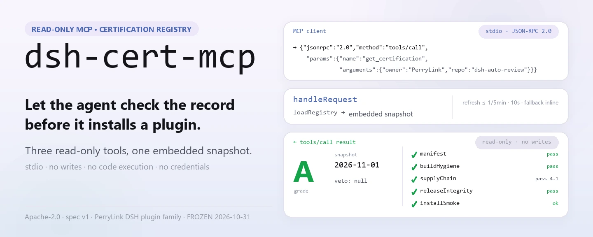
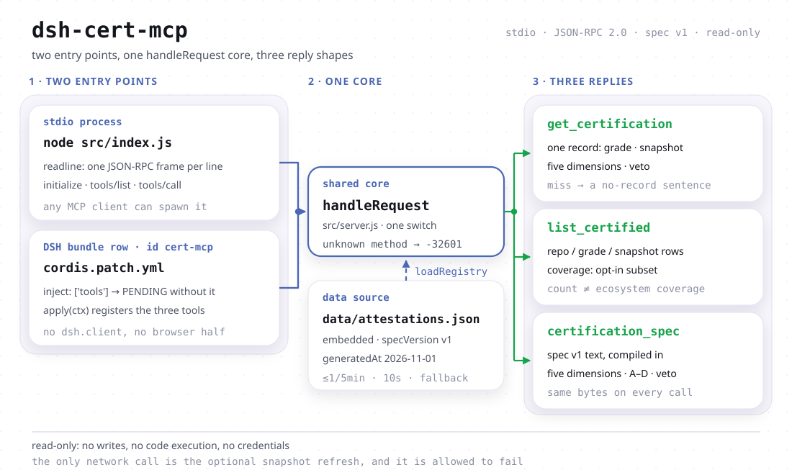

<div align="center">

<picture>
  <source media="(prefers-color-scheme: dark)" srcset="docs/assets/dsh-cert-mcp-hero-en-dark.webp">
  
</picture>

# dsh-cert-mcp

**Un endpoint MCP de solo lectura que entrega al agente los grados de certificación, las fechas de instantánea y la evidencia en cinco dimensiones de los plugins de DSH.**

Antes de recomendar o instalar un plugin, el agente puede consultar su registro de certificación: el grado, la fecha en que se midió, el resultado de las cinco dimensiones y si se activó un veto. Tres herramientas de solo lectura, una instantánea integrada, transporte stdio: sin escrituras, sin ejecución de código y sin credenciales.

[Instalación](#inicio-rápido) · [Herramientas](#capacidades) · [Registro](#datos-y-cobertura) · [FAQ](#faq) · [简体中文](README.md) · [English](README.en.md) · [Español](README.es.md) · [Português](README.pt.md) · [हिन्दी](README.hi.md)

[](LICENSE)
[](#compatibilidad)
[](https://www.npmjs.com/package/dsh-cert-mcp)
[](https://github.com/PerryLink/dsh-cert-mcp/actions/workflows/smoke.yml)
[](#compatibilidad)

[](https://github.com/PerryLink/dsh-cert-mcp/stargazers)
[](https://www.npmjs.com/package/dsh-cert-mcp)
[](https://dshfind.com/es/plugins/PerryLink/dsh-cert-mcp?ref=badge)
[](https://dsh.market/)
[](https://gitee.com/perrylink/dsh-cert-mcp)

```sh
dsh plugin --profile <name> add dsh-cert-mcp
```

</div>

<sub>Plugin de la comunidad, sin afiliación con DeepSeek. Repositorio canónico: <https://github.com/PerryLink/dsh-cert-mcp> (Gitee es un espejo). Estado de mantenimiento: 🧊 CONGELADO desde el 2026-10-31 — solo integración de referencia.</sub>

## Qué es

Un servidor MCP de solo lectura: expone el registro de `dsh-plugin-certification` como tres herramientas que el agente puede llamar — el grado, la fecha de instantánea y la evidencia en cinco dimensiones de un registro; todas las filas del registro más una declaración de cobertura; y la especificación v1 completa. Cero dependencias de ejecución y JSON-RPC delimitado por líneas sobre stdin/stdout, así que cualquier cliente MCP con stdio puede lanzarlo. El mismo núcleo `handleRequest` lo reutiliza la mitad bundle de DSH, de modo que al instalar el bundle las tres herramientas aparecen directamente en la superficie de herramientas de DSH.

Lo que deliberadamente no hace: no escribe, no ejecuta nada, no necesita credenciales y no decide si un plugin merece instalarse. Que no haya registro **no** significa que el plugin no esté certificado (el registro es un subconjunto opt-in), y un grado A **no** es una garantía de seguridad (un grado es un registro de evidencia; los plugins se ejecutan dentro de tu proceso DSH con tus permisos).

<picture>
  <source media="(prefers-color-scheme: dark)" srcset="docs/assets/dsh-cert-mcp-flow-v5-dark.svg">
  
</picture>

## Inicio rápido

### 1. Instalar (tres canales)

```sh
dsh plugin --profile web add dsh-cert-mcp                   # canal npm (publicado)
dsh plugin --profile web add github:PerryLink/dsh-cert-mcp  # canal git (main)
npx dsh-cert-mcp                                            # o ejecutarlo como servidor stdio
```

El paquete declara `dsh.bundle.patch` → `cordis.patch.yml`, así que al instalarlo se inserta una fila de bundle (`id: cert-mcp`). También puedes usarlo como servidor MCP simple: `node src/index.js` o `npx dsh-cert-mcp`. Ninguna vía arranca la otra (ver «dos mitades»).

### 2. Registrarlo en un cliente MCP

Claude Code:

```sh
claude mcp add dsh-cert -- node <path-to-repo>/src/index.js
```

Claude Desktop (`claude_desktop_config.json`):

```json
{
  "mcpServers": {
    "dsh-cert": {
      "command": "node",
      "args": ["<path-to-repo>/src/index.js"]
    }
  }
}
```

DSH: añádelo con [dsh-mcp-panel](https://github.com/PerryLink/dsh-mcp-panel) como servidor stdio, o instala el bundle del paso anterior.

### 3. Verificar

```sh
printf '%s\n' '{"jsonrpc":"2.0","id":1,"method":"initialize","params":{}}' | node src/index.js
```

Responde con una línea:

```text
{"jsonrpc":"2.0","id":1,"result":{"protocolVersion":"2024-11-05","capabilities":{"tools":{}},"serverInfo":{"name":"dsh-cert-mcp","version":"0.2.13"}}}
```

Después, `tools/list` devuelve las tres herramientas.

*Observado en `src/server.js:165-176` (respuesta a initialize) y `src/index.js:9-23` (stdio delimitado por líneas); la versión sale de `package.json`.*

## Capacidades

### Las tres herramientas

| Herramienta | Entrada | Devuelve | Cuándo usarla |
|---|---|---|---|
| `get_certification` | `owner`, `repo` (sin distinguir mayúsculas) | el registro completo en JSON: `grade`, `snapshot`, `specVersion`, las cinco dimensiones, `veto`, `notes`, `selfAssessed`, `assessor` | ya sabes de qué plugin hablas y quieres su grado o la evidencia |
| `list_certified` | ninguna | `specVersion`, `generatedAt`, `count`, `coverage`, `entries[]` (repo / grade / snapshot) | quieres ver qué contiene el registro o comparar entre plugins |
| `certification_spec` | ninguna | la especificación v1 completa: cinco dimensiones A–E, escala de grados, regla de veto y disciplina de evidencia | leíste un grado y quieres saber qué significa |

Las tres declaran las anotaciones de solo lectura de MCP (`readOnlyHint: true` / `destructiveHint: false` / `idempotentHint: true` / `openWorldHint: false`) y las llamadas repetidas con los mismos argumentos devuelven el mismo registro. Cada `tools/call` pasa primero por `loadRegistry`: dentro de la ventana de cinco minutos usa la instantánea actual; si no, intenta una vez el registro público, espera como máximo diez segundos y conserva la instantánea integrada si falla.

### Dos mitades, una sola ruta de datos

La fila del bundle y el servidor stdio son dos entradas sobre un mismo núcleo `handleRequest`:

- **La mitad servidor** (`src/index.js`, nombre bin `dsh-cert-mcp`) es un proceso independiente que cualquier cliente MCP puede lanzar. **No** está en la ruta del plugin: instalar el bundle nunca lo arranca y quitarlo nunca lo toca.
- **La mitad bundle** (`src/plugin.js`) la carga la fila de `cordis.patch.yml`, declara `inject = ['tools']` y pone las tres herramientas en la superficie de DSH. A la inversa, `npx dsh-cert-mcp` no registra nada en esa superficie.

```js
// src/plugin.js — the contract the patch row loads
export const name = 'dsh-cert-mcp'
export const inject = ['tools'] // the host tool surface, provided by dsh-tools
export function apply(ctx) {
  // registers the three read-only tools on ctx.tools, 1:1
}
```

`tools` es una dependencia dura: un perfil sin ese servicio no pierde las herramientas en silencio, Cordis deja la fila en `PENDING` y se ve en la lista de plugins del perfil. No hace falta nada más: ni claves de configuración, ni credenciales, ni red al cargar. El paquete no incluye interfaz de navegador, así que no hay declaración `dsh.client`.

### Ejemplos: llamadas reales

#### Ejemplo detallado

**Llamada**

~~~text
get_certification
~~~

**Entrada**

~~~json
{ "owner": "PerryLink", "repo": "dsh-auto-review" }
~~~

**Salida**(`dimensions.*.evidence` se recorta a `…` por anchura; el resto de campos es literal de la instantánea)

```json
{
  "repo": "PerryLink/dsh-auto-review",
  "grade": "A",
  "specVersion": "v1",
  "snapshot": "2026-11-01",
  "dimensions": {
    "manifest": { "result": "pass", "evidence": "…" },
    "buildHygiene": { "result": "pass", "evidence": "…" },
    "supplyChain": { "result": "pass", "score": 4.1, "evidence": "…" },
    "releaseIntegrity": { "result": "pass", "evidence": "…" },
    "installSmoke": { "result": "ok", "evidence": "…" }
  },
  "veto": null,
  "notes": "Re-audited at 0.15.0 on 2026-11-01; grade A retained. … Self-assessed: the certifier and the plugin author are the same maintainer …",
  "selfAssessed": true,
  "assessor": "PerryLink (maintainer; same party as the plugin author)"
}
```

*Observado en `src/server.js:192-199`; datos de `data/attestations.json`.*

#### Rama de fallo

**Entrada**

~~~text
{"owner":"nobody","repo":"nothing"}
~~~

**Salida**

~~~text
No certification record for nobody/nothing in registry snapshot 2026-11-01.
~~~

*Observado en `src/server.js:191-199`; cuando no hay registro lo dice sin inventar un grado.*

#### Ejemplos breves

- `list_certified` → `count: 1`, `coverage.certified: 1`, más la frase que aclara que el registro solo lista repositorios evaluados y no es un censo
- `certification_spec` → especificación v1 completa (cinco dimensiones A–E, grados A–D, regla de veto, disciplina de evidencia)

## Datos y cobertura

El registro es un **subconjunto opt-in** de `dsh-plugin-certification`: un repositorio aparece solo después de ser evaluado y registrado. Cuatro consecuencias:

- **Sin registro ≠ sin certificar.** Un registro ausente solo dice que el registro público no lo contiene; no dice que el plugin no se haya evaluado ni que tenga algún problema.
- **Cantidad ≠ cobertura del ecosistema.** Una respuesta corta de `list_certified` no prueba que se evaluaran pocos plugins; el registro no guarda cuántos candidatos existen, así que aquí no se ofrece ningún denominador «N de M»: ese número sería inventado.
- **Una lista de un solo elemento no tiene significado estadístico.** La instantánea integrada contiene exactamente un registro (`PerryLink/dsh-auto-review`, grado A, instantánea 2026-11-01 y `selfAssessed: true`: quien evalúa y el autor del plugin son el mismo mantenedor, así que no es certificación independiente). Un grado describe ese repositorio; la comparación ordenable solo llega cuando el registro crece.
- **La fecha de la instantánea es un hecho del repositorio de certificación.** `data/attestations.json` se sincroniza byte a byte desde `dsh-plugin-certification` (`schema: dsh-attestation-registry/1`, `specVersion: v1`); ese repositorio es dueño del calendario y de la puerta de calidad. Este servidor solo transporta los datos.

Cada respuesta de `list_certified` lleva un objeto `coverage` (`certified` / `subset` / `scope` / `representative` / `registry` / `generatedAt`) que viaja junto a los números, de modo que un agente que solo lee la salida no confunda la cantidad con cobertura del ecosistema.

## FAQ

**¿Por qué falta un plugin en el registro?**

El registro es un subconjunto opt-in: solo lista repositorios evaluados y registrados. Su ausencia no significa que el plugin no esté certificado. La evaluación vive en `dsh-plugin-certification`, no aquí.

**¿Este repositorio recibirá nuevas funciones?**

No. Se congeló el 2026-10-31 y queda como integración de referencia; el registro y las reglas de evaluación son de `dsh-plugin-certification`.

**¿Necesita red o credenciales?**

Ninguna credencial. La única llamada saliente es la actualización de la instantánea (como máximo una vez cada cinco minutos, con diez segundos de espera) y si falla se mantiene la instantánea integrada. `initialize` y `tools/list` no hacen ninguna llamada de red; las tres herramientas pasan por `loadRegistry`, que tampoco sale a la red mientras la ventana de actualización está abierta.

**¿Hay que instalar el bundle y el servidor stdio?**

No. Son independientes: el bundle solo afecta la superficie de DSH y el servidor stdio solo sirve a clientes MCP. Mismo núcleo, ninguno arranca al otro.

**¿Un grado A significa que el plugin es seguro?**

No. Un grado es un registro de evidencia (manifiesto, higiene de build, Scorecard de cadena de suministro, procedencia de la publicación, prueba de instalación en sandbox), no una garantía de seguridad; los plugins se ejecutan en tu proceso con tus permisos.

**¿Cambia la fecha de la instantánea tras una actualización?**

Sigue al registro público. Esa fecha es un hecho del repositorio de certificación, no una promesa de frescura de este servidor.

## Límites conocidos

- **Congelado el 2026-10-31.** Sin nuevas funciones de certificación y sin cambios que conviertan este repositorio en la fuente del registro.
- **La instantánea integrada tiene un solo registro.** La ordenación y la comparación en `list_certified` todavía no tienen con qué comparar.
- **Sin superficie de escritura.** No se puede enviar una certificación, disparar una reevaluación ni editar la instantánea; las actualizaciones solo llegan desde arriba.
- **La actualización es best-effort.** Un acierto de caché no sale a la red y un tiempo de espera agotado vuelve a la instantánea integrada en silencio, sin línea de log adicional.
- **La versión de protocolo está fijada en `2024-11-05`** y la única capacidad declarada es `tools`; no hay resources ni prompts.
- **Sin autenticación.** Cualquiera que pueda ejecutar el proceso puede leer el registro (los datos ya son públicos).
- **Un grado no es un escaneo de seguridad en vivo.** `veto` aparece solo si el repositorio de certificación lo registró; este servidor no vuelve a juzgar.

## Compatibilidad

| Superficie | Estado |
|---|---|
| Harness | `engines.dsh`: `>=0.2.1-0 <0.3.0 \|\| >=0.2.2-0 <0.3.0`; el desarrollo y las pruebas corren contra `@deepseek-ai/dsh-system-prompt` / `@deepseek-ai/dsh-tools` 0.2.2-rc.1 |
| Node | `^22.19.0 \|\| >=24.9.0` (`engines.node` en `package.json`) |
| Peer | `@deepseek-ai/cordis` `^4.0.2`. La mitad bundle necesita además el servicio `tools`; la mitad stdio no necesita nada más que Node. |
| MCP | Versión de protocolo `2024-11-05`, solo capacidad `tools`, transporte stdio |
| Dependencias de ejecución | Ninguna: `package.json` no declara `dependencies` |

## Desarrollo

```sh
pnpm install
pnpm run typecheck     # la única regla de tipos: checkJs sobre la cara publicada
pnpm test              # humo JSON-RPC + suite de ejecución con Cordis real
pnpm run check:readmes # puerta de sincronía de los cinco README
pnpm pack
```

La suite monta los registros REALES `SystemPrompt` / `ToolRuntime` y comprueba que montar este paquete mete las tres herramientas en `ctx.tools.schemas()`, que liberar el fiber las quita y que un contexto sin el servicio `tools` deja el plugin en `PENDING`. No se usa `dsh --dump-config` como aceptación: allí una fila montada y un fiber pendiente se ven igual.

Hay deliberadamente una sola regla de tipos: `@deepseek-ai/*` se resuelve con el `node_modules` de este repositorio (las devDependencies fijadas) y el paquete no declara peer de DSH, así que una segunda configuración de `tsc` sería el mismo comando sobre el mismo universo de tipos. La segunda evidencia independiente es la puerta de montaje en ejecución.

## Familia y créditos

Este proyecto forma parte de la familia de plugins de DeepSeek Harness de [PerryLink](https://github.com/PerryLink). La lista queda plegada para que cada README conserve una primera pantalla corta.

<details>
<summary>Expandir todos los plugins</summary>

| Plugin | Estado |
|---|---|
| **[dsh-aqua-input-check](https://github.com/PerryLink/dsh-aqua-input-check)** |  |
| **[dsh-archive-check](https://github.com/PerryLink/dsh-archive-check)** |  |
| **[dsh-auto-review](https://github.com/PerryLink/dsh-auto-review)** |  |
| **[dsh-autotier](https://github.com/PerryLink/dsh-autotier)** |  |
| **[dsh-bid-ca-precheck](https://github.com/PerryLink/dsh-bid-ca-precheck)** |  |
| **[dsh-bid-qual-check](https://github.com/PerryLink/dsh-bid-qual-check)** |  |
| **[dsh-cert-mcp](https://github.com/PerryLink/dsh-cert-mcp)** |  |
| **[dsh-checkpoint-rewind](https://github.com/PerryLink/dsh-checkpoint-rewind)** |  |
| **[dsh-click](https://github.com/PerryLink/dsh-click)** |  |
| **[dsh-composer-history](https://github.com/PerryLink/dsh-composer-history)** |  |
| **[dsh-contract-stance](https://github.com/PerryLink/dsh-contract-stance)** |  |
| **[dsh-customs-doc-check](https://github.com/PerryLink/dsh-customs-doc-check)** |  |
| **[dsh-data-quality](https://github.com/PerryLink/dsh-data-quality)** |  |
| **[dsh-demurrage-ledger](https://github.com/PerryLink/dsh-demurrage-ledger)** |  |
| **[dsh-doublecheck](https://github.com/PerryLink/dsh-doublecheck)** |  |
| **[dsh-drill-script-check](https://github.com/PerryLink/dsh-drill-script-check)** |  |
| **[dsh-eia-guide-check](https://github.com/PerryLink/dsh-eia-guide-check)** |  |
| **[dsh-emergency-plan](https://github.com/PerryLink/dsh-emergency-plan)** |  |
| **[dsh-essay-rubric-check](https://github.com/PerryLink/dsh-essay-rubric-check)** |  |
| **[dsh-evidence-check](https://github.com/PerryLink/dsh-evidence-check)** |  |
| **[dsh-export-ctl-check](https://github.com/PerryLink/dsh-export-ctl-check)** |  |
| **[dsh-fast](https://github.com/PerryLink/dsh-fast)** |  |
| **[dsh-fmea-table-check](https://github.com/PerryLink/dsh-fmea-table-check)** |  |
| **[dsh-forecast-penalty](https://github.com/PerryLink/dsh-forecast-penalty)** |  |
| **[dsh-fund-research](https://github.com/PerryLink/dsh-fund-research)** |  |
| **[dsh-github](https://github.com/PerryLink/dsh-github)** |  |
| **[dsh-gongwen-flow-check](https://github.com/PerryLink/dsh-gongwen-flow-check)** |  |
| **[dsh-gongwen-word-check](https://github.com/PerryLink/dsh-gongwen-word-check)** |  |
| **[dsh-guard-plan-qc](https://github.com/PerryLink/dsh-guard-plan-qc)** |  |
| **[dsh-hazchem-check](https://github.com/PerryLink/dsh-hazchem-check)** |  |
| **[dsh-hazplan-check](https://github.com/PerryLink/dsh-hazplan-check)** |  |
| **[dsh-hidden-risk-map](https://github.com/PerryLink/dsh-hidden-risk-map)** |  |
| **[dsh-hs-classify](https://github.com/PerryLink/dsh-hs-classify)** |  |
| **[dsh-icd-rule-check](https://github.com/PerryLink/dsh-icd-rule-check)** |  |
| **[dsh-industry-research](https://github.com/PerryLink/dsh-industry-research)** |  |
| **[dsh-lawcite-adapter](https://github.com/PerryLink/dsh-lawcite-adapter)** |  |
| **[dsh-laya](https://github.com/PerryLink/dsh-laya)** |  |
| **[dsh-lc-doc-check](https://github.com/PerryLink/dsh-lc-doc-check)** |  |
| **[dsh-learning-gap-check](https://github.com/PerryLink/dsh-learning-gap-check)** |  |
| **[dsh-library](https://github.com/PerryLink/dsh-library)** |  |
| **[dsh-local-ai](https://github.com/PerryLink/dsh-local-ai)** |  |
| **[dsh-lsp-actions](https://github.com/PerryLink/dsh-lsp-actions)** |  |
| **[dsh-mask](https://github.com/PerryLink/dsh-mask)** |  |
| **[dsh-mcp-panel](https://github.com/PerryLink/dsh-mcp-panel)** |  |
| **[dsh-medrec-qc](https://github.com/PerryLink/dsh-medrec-qc)** |  |
| **[dsh-memento](https://github.com/PerryLink/dsh-memento)** |  |
| **[dsh-nsfc-form-check](https://github.com/PerryLink/dsh-nsfc-form-check)** |  |
| **[dsh-nurse-record-check](https://github.com/PerryLink/dsh-nurse-record-check)** |  |
| **[dsh-observe](https://github.com/PerryLink/dsh-observe)** |  |
| **[dsh-origin-rvc-check](https://github.com/PerryLink/dsh-origin-rvc-check)** |  |
| **[dsh-ota-review-check](https://github.com/PerryLink/dsh-ota-review-check)** |  |
| **[dsh-output-styles](https://github.com/PerryLink/dsh-output-styles)** |  |
| **[dsh-paper-doc-adapter](https://github.com/PerryLink/dsh-paper-doc-adapter)** |  |
| **[dsh-permission-rules](https://github.com/PerryLink/dsh-permission-rules)** |  |
| **[dsh-permit-report-check](https://github.com/PerryLink/dsh-permit-report-check)** |  |
| **[dsh-pipeline-check](https://github.com/PerryLink/dsh-pipeline-check)** |  |
| **[dsh-pleading-draft](https://github.com/PerryLink/dsh-pleading-draft)** |  |
| **[dsh-plugin-doctor](https://github.com/PerryLink/dsh-plugin-doctor)** |  |
| **[dsh-plugin-guide](https://github.com/PerryLink/dsh-plugin-guide)** |  |
| **[dsh-plugin-kit](https://github.com/PerryLink/dsh-plugin-kit)** |  |
| **[dsh-plugin-upgrade](https://github.com/PerryLink/dsh-plugin-upgrade)** |  |
| **[dsh-policy-brief-draft](https://github.com/PerryLink/dsh-policy-brief-draft)** |  |
| **[dsh-power-loss-split](https://github.com/PerryLink/dsh-power-loss-split)** |  |
| **[dsh-power-ticket-check](https://github.com/PerryLink/dsh-power-ticket-check)** |  |
| **[dsh-ppap-check](https://github.com/PerryLink/dsh-ppap-check)** |  |
| **[dsh-protest-deadline](https://github.com/PerryLink/dsh-protest-deadline)** |  |
| **[dsh-railway-window](https://github.com/PerryLink/dsh-railway-window)** |  |
| **[dsh-repair-order-qc](https://github.com/PerryLink/dsh-repair-order-qc)** |  |
| **[dsh-research-report](https://github.com/PerryLink/dsh-research-report)** |  |
| **[dsh-review-reply-check](https://github.com/PerryLink/dsh-review-reply-check)** |  |
| **[dsh-rulefile-check](https://github.com/PerryLink/dsh-rulefile-check)** |  |
| **[dsh-safety-brief-check](https://github.com/PerryLink/dsh-safety-brief-check)** |  |
| **[dsh-score](https://github.com/PerryLink/dsh-score)** |  |
| **[dsh-session-sync](https://github.com/PerryLink/dsh-session-sync)** |  |
| **[dsh-site-log-check](https://github.com/PerryLink/dsh-site-log-check)** |  |
| **[dsh-skill-pack-security](https://github.com/PerryLink/dsh-skill-pack-security)** |  |
| **[dsh-soe-decision-check](https://github.com/PerryLink/dsh-soe-decision-check)** |  |
| **[dsh-soilwater-check](https://github.com/PerryLink/dsh-soilwater-check)** |  |
| **[dsh-sop-sync-check](https://github.com/PerryLink/dsh-sop-sync-check)** |  |
| **[dsh-spc-gbt-adapter](https://github.com/PerryLink/dsh-spc-gbt-adapter)** |  |
| **[dsh-talk](https://github.com/PerryLink/dsh-talk)** |  |
| **[dsh-tender-extract](https://github.com/PerryLink/dsh-tender-extract)** |  |
| **[dsh-tender-matrix](https://github.com/PerryLink/dsh-tender-matrix)** |  |
| **[dsh-test-drive](https://github.com/PerryLink/dsh-test-drive)** |  |
| **[dsh-ticktick](https://github.com/PerryLink/dsh-ticktick)** |  |
| **[dsh-translate](https://github.com/PerryLink/dsh-translate)** |  |
| **[dsh-warranty-calc](https://github.com/PerryLink/dsh-warranty-calc)** |  |
| **[dsh-budget](https://github.com/PerryLink/dsh-budget)** | 🧊 CONGELADO — ver el README del repositorio |
| **[dsh-claude-move](https://github.com/PerryLink/dsh-claude-move)** | 🧊 CONGELADO — ver el README del repositorio |
| **[dsh-defend](https://github.com/PerryLink/dsh-defend)** | 🧊 CONGELADO — ver el README del repositorio |
| **[dsh-draw](https://github.com/PerryLink/dsh-draw)** | 🧊 CONGELADO — ver el README del repositorio |
| **[dsh-reach](https://github.com/PerryLink/dsh-reach)** | 🧊 CONGELADO — ver el README del repositorio |
| **[dsh-background-agents](https://github.com/PerryLink/dsh-background-agents)** | 🚫 RETIRADO — ver el README del repositorio |
| **[dsh-session-pin](https://github.com/PerryLink/dsh-session-pin)** | 🚫 RETIRADO — ver el README del repositorio |
| **[dsh-team-rooms](https://github.com/PerryLink/dsh-team-rooms)** | 🚫 RETIRADO — ver el README del repositorio |

</details>

Créditos: el registro y la especificación de cinco dimensiones los mantiene [dsh-plugin-certification](https://github.com/PerryLink/dsh-plugin-certification); el lado del protocolo es [Model Context Protocol](https://modelcontextprotocol.io); la consola MCP de DSH es [dsh-mcp-panel](https://github.com/PerryLink/dsh-mcp-panel).

## License

Apache-2.0. Un listado o un grado es un registro de evidencia, no una garantía de seguridad: los plugins se ejecutan dentro de tu proceso DSH con tus permisos.
