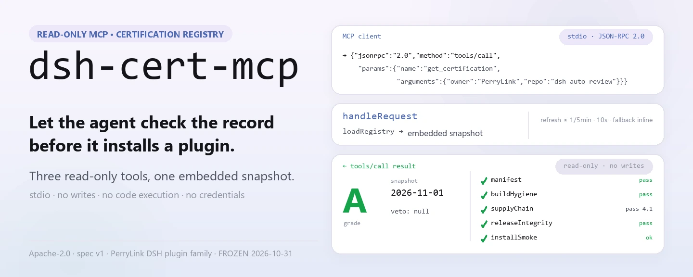
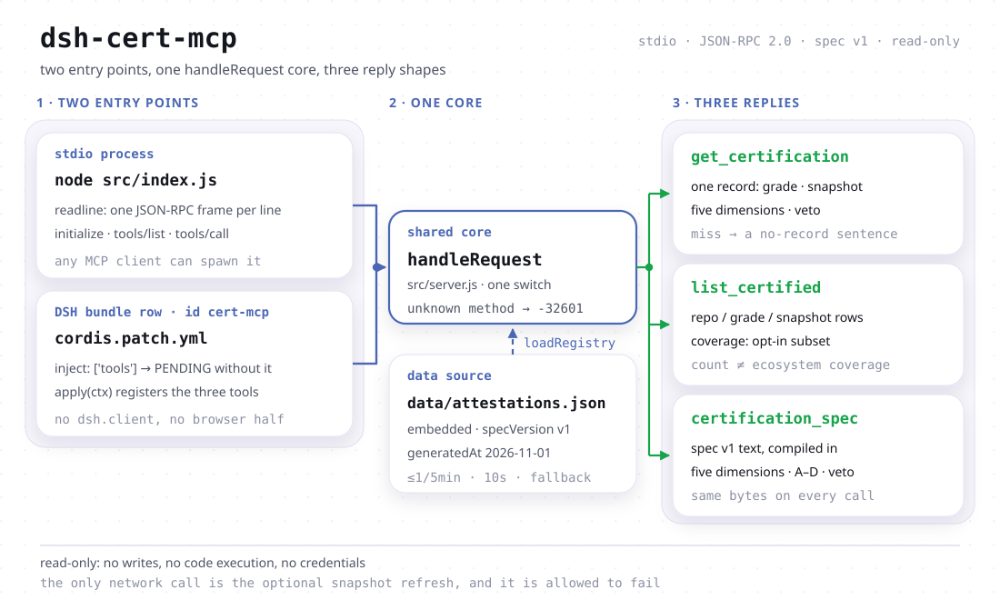

<div align="center">

<picture>
  <source media="(prefers-color-scheme: dark)" srcset="docs/assets/dsh-cert-mcp-hero-en-dark.webp">
  
</picture>

# dsh-cert-mcp

**एक read-only MCP endpoint जो DSH प्लगइन के प्रमाणन ग्रेड, स्नैपशॉट तिथियाँ और पाँच-आयामी साक्ष्य agent तक पहुँचाता है।**

किसी प्लगइन की सिफ़ारिश या इंस्टॉल से पहले agent उसका प्रमाणन रिकॉर्ड देख सकता है: ग्रेड क्या है, किस तारीख को मापा गया, पाँच आयामों का परिणाम क्या रहा और कोई veto लगा या नहीं। तीन read-only टूल, एक अंतर्निहित स्नैपशॉट, stdio ट्रांसपोर्ट — कोई लेखन नहीं, कोई कोड निष्पादन नहीं, कोई क्रेडेंशियल नहीं।

[इंस्टॉल](#त्वरित-शुरुआत) · [टूल](#क्षमताएँ) · [रजिस्ट्री](#डेटा-और-कवरेज) · [FAQ](#faq) · [简体中文](README.md) · [English](README.en.md) · [Español](README.es.md) · [Português](README.pt.md) · [हिन्दी](README.hi.md)

[](LICENSE)
[](#अनुकूलता)
[](https://www.npmjs.com/package/dsh-cert-mcp)
[](https://github.com/PerryLink/dsh-cert-mcp/actions/workflows/smoke.yml)
[](#अनुकूलता)

[](https://github.com/PerryLink/dsh-cert-mcp/stargazers)
[](https://www.npmjs.com/package/dsh-cert-mcp)
[](https://dshfind.com/hi/plugins/PerryLink/dsh-cert-mcp?ref=badge)
[](https://dsh.market/)
[](https://gitee.com/perrylink/dsh-cert-mcp)

```sh
dsh plugin --profile <name> add dsh-cert-mcp
```

</div>

<sub>समुदाय द्वारा बनाया गया प्लगइन, DeepSeek से संबद्ध नहीं। मूल रिपॉज़िटरी: <https://github.com/PerryLink/dsh-cert-mcp> (Gitee एक मिरर है)। रखरखाव स्थिति: 🧊 2026-10-31 से फ़्रीज़ — केवल संदर्भ एकीकरण।</sub>

## यह क्या है

एक read-only MCP सर्वर: यह `dsh-plugin-certification` रजिस्ट्री को तीन ऐसे टूल के रूप में उजागर करता है जिन्हें agent सीधे कॉल कर सकता है — किसी एक रिकॉर्ड का ग्रेड, स्नैपशॉट तिथि और पाँच-आयामी साक्ष्य; पूरी रजिस्ट्री की पंक्तियाँ और कवरेज का बयान; और स्वयं spec v1। शून्य रनटाइम निर्भरताएँ, stdin/stdout पर लाइन-विभाजित JSON-RPC, इसलिए stdio जानने वाला कोई भी MCP क्लाइंट इसे चला सकता है। वही `handleRequest` कोर DSH bundle आधे हिस्से में भी दोबारा इस्तेमाल होता है, इसलिए bundle इंस्टॉल करते ही तीनों टूल सीधे DSH टूल सतह पर आ जाते हैं।

जो यह जानबूझकर नहीं करता: कोई फ़ाइल नहीं लिखता, कुछ निष्पादित नहीं करता, क्रेडेंशियल नहीं माँगता, और यह तय नहीं करता कि कोई प्लगइन “इंस्टॉल करने योग्य” है या नहीं। रिकॉर्ड न मिलना **इसका अर्थ नहीं** कि प्लगइन प्रमाणित नहीं है (रजिस्ट्री opt-in उपसमुच्चय है), और A ग्रेड **सुरक्षा की गारंटी नहीं** है (ग्रेड साक्ष्य का रिकॉर्ड है; प्लगइन आपके DSH प्रोसेस में आपकी अनुमतियों के साथ चलते हैं)।

<picture>
  <source media="(prefers-color-scheme: dark)" srcset="docs/assets/dsh-cert-mcp-flow-v5-dark.svg">
  
</picture>

## त्वरित शुरुआत

### 1. इंस्टॉल (तीन तरीके)

```sh
dsh plugin --profile web add dsh-cert-mcp                   # npm चैनल (प्रकाशित)
dsh plugin --profile web add github:PerryLink/dsh-cert-mcp  # git चैनल (main)
npx dsh-cert-mcp                                            # या सीधे stdio सर्वर की तरह चलाएँ
```

पैकेज `dsh.bundle.patch` → `cordis.patch.yml` घोषित करता है, इसलिए इंस्टॉल करने पर एक bundle पंक्ति (`id: cert-mcp`) जुड़ती है। इसे सादे MCP सर्वर की तरह भी इस्तेमाल किया जा सकता है: `node src/index.js` या `npx dsh-cert-mcp`। दोनों रास्ते एक-दूसरे को शुरू नहीं करते (देखें “दो आधे हिस्से”)।

### 2. MCP क्लाइंट में रजिस्टर करें

Claude Code:

```sh
claude mcp add dsh-cert -- node <path-to-repo>/src/index.js
```

Claude Desktop (`claude_desktop_config.json`):

```json
{
  "mcpServers": {
    "dsh-cert": {
      "command": "node",
      "args": ["<path-to-repo>/src/index.js"]
    }
  }
}
```

DSH: [dsh-mcp-panel](https://github.com/PerryLink/dsh-mcp-panel) से stdio सर्वर की तरह जोड़ें, या पिछले चरण का bundle इंस्टॉल करें।

### 3. सत्यापन

```sh
printf '%s\n' '{"jsonrpc":"2.0","id":1,"method":"initialize","params":{}}' | node src/index.js
```

यह एक पंक्ति में उत्तर देता है:

```text
{"jsonrpc":"2.0","id":1,"result":{"protocolVersion":"2024-11-05","capabilities":{"tools":{}},"serverInfo":{"name":"dsh-cert-mcp","version":"0.2.13"}}}
```

इसके बाद `tools/list` तीनों टूल दिखाता है।

*`src/server.js:165-176` (initialize उत्तर) और `src/index.js:9-23` (लाइन-विभाजित stdio) से मापा गया; संस्करण `package.json` से।*

## क्षमताएँ

### तीन टूल

| टूल | इनपुट | लौटाता है | कब इस्तेमाल करें |
|---|---|---|---|
| `get_certification` | `owner`, `repo` (केस-असंवेदी) | पूरा रिकॉर्ड JSON: `grade`, `snapshot`, `specVersion`, पाँच आयाम, `veto`, `notes`, `selfAssessed`, `assessor` | आप जानते हैं कौन-सा प्लगइन है और उसका ग्रेड या उसके पीछे का साक्ष्य चाहिए |
| `list_certified` | कोई नहीं | `specVersion`, `generatedAt`, `count`, `coverage`, `entries[]` (repo / grade / snapshot) | रजिस्ट्री में क्या है यह देखना है, या प्लगइनों की तुलना करनी है |
| `certification_spec` | कोई नहीं | पूरा spec v1: पाँच आयाम A–E, ग्रेड स्केल, veto नियम, साक्ष्य अनुशासन | कोई ग्रेड पढ़ा और जानना है कि उसका अर्थ क्या है |

तीनों MCP read-only एनोटेशन घोषित करते हैं (`readOnlyHint: true` / `destructiveHint: false` / `idempotentHint: true` / `openWorldHint: false`) और एक ही आर्ग्युमेंट के साथ दोहराया गया कॉल वही रिकॉर्ड लौटाता है। हर `tools/call` पहले `loadRegistry` से गुज़रता है: पाँच मिनट की विंडो में मौजूदा स्नैपशॉट इस्तेमाल होता है, वरना सार्वजनिक रजिस्ट्री से एक बार प्रयास होता है, अधिकतम दस सेकंड प्रतीक्षा, और विफल होने पर अंतर्निहित स्नैपशॉट बना रहता है।

### दो आधे हिस्से, एक ही डेटा पथ

bundle पंक्ति और stdio सर्वर एक ही `handleRequest` कोर के दो प्रवेश बिंदु हैं:

- **सर्वर आधा** (`src/index.js`, bin नाम `dsh-cert-mcp`) एक स्वतंत्र प्रोसेस है जिसे कोई भी MCP क्लाइंट चला सकता है। यह **प्लगइन पथ पर नहीं** है: bundle इंस्टॉल करने से यह शुरू नहीं होता और bundle हटाने से यह छूता तक नहीं।
- **bundle आधा** (`src/plugin.js`) `cordis.patch.yml` की उस पंक्ति से लोड होता है, `inject = ['tools']` घोषित करता है और तीनों टूल DSH टूल सतह पर लगाता है। उलटी दिशा में, `npx dsh-cert-mcp` DSH टूल सतह पर कुछ भी रजिस्टर नहीं करता।

```js
// src/plugin.js — the contract the patch row loads
export const name = 'dsh-cert-mcp'
export const inject = ['tools'] // the host tool surface, provided by dsh-tools
export function apply(ctx) {
  // registers the three read-only tools on ctx.tools, 1:1
}
```

`tools` कठोर निर्भरता है: उस सेवा के बिना प्रोफ़ाइल चुपचाप टूल नहीं खोती — Cordis उस पंक्ति को `PENDING` में रोक देता है, जो प्रोफ़ाइल की प्लगइन सूची में दिखता है। इसके अलावा कुछ नहीं चाहिए: कोई कॉन्फ़िग कुंजी नहीं, कोई क्रेडेंशियल नहीं, और लोड के समय कोई नेटवर्क नहीं। पैकेज में ब्राउज़र UI नहीं है, इसलिए `dsh.client` घोषणा भी नहीं है।

### उदाहरण: असली कॉल

#### विस्तृत उदाहरण

**कॉल**

~~~text
get_certification
~~~

**इनपुट**

~~~json
{ "owner": "PerryLink", "repo": "dsh-auto-review" }
~~~

**आउटपुट**(`dimensions.*.evidence` चौड़ाई के लिए `…` कर दिया गया है; बाकी सभी फ़ील्ड स्नैपशॉट से शब्दशः हैं)

```json
{
  "repo": "PerryLink/dsh-auto-review",
  "grade": "A",
  "specVersion": "v1",
  "snapshot": "2026-11-01",
  "dimensions": {
    "manifest": { "result": "pass", "evidence": "…" },
    "buildHygiene": { "result": "pass", "evidence": "…" },
    "supplyChain": { "result": "pass", "score": 4.1, "evidence": "…" },
    "releaseIntegrity": { "result": "pass", "evidence": "…" },
    "installSmoke": { "result": "ok", "evidence": "…" }
  },
  "veto": null,
  "notes": "Re-audited at 0.15.0 on 2026-11-01; grade A retained. … Self-assessed: the certifier and the plugin author are the same maintainer …",
  "selfAssessed": true,
  "assessor": "PerryLink (maintainer; same party as the plugin author)"
}
```

*`src/server.js:192-199` से मापा गया; डेटा `data/attestations.json` से।*

#### विफलता शाखा

**इनपुट**

~~~text
{"owner":"nobody","repo":"nothing"}
~~~

**आउटपुट**

~~~text
No certification record for nobody/nothing in registry snapshot 2026-11-01.
~~~

*`src/server.js:191-199` से मापा गया; रिकॉर्ड न मिलने पर यह साफ़ कहता है और ग्रेड का अनुमान नहीं लगाता।*

#### संक्षिप्त उदाहरण

- `list_certified` → `count: 1`, `coverage.certified: 1`, साथ में वह वाक्य जो बताता है कि रजिस्ट्री केवल मूल्यांकित रिपॉज़िटरी सूचीबद्ध करती है और जनगणना नहीं है
- `certification_spec` → पूरा spec v1 (पाँच आयाम A–E, ग्रेड A–D, veto नियम, साक्ष्य अनुशासन)

## डेटा और कवरेज

रजिस्ट्री `dsh-plugin-certification` का **opt-in उपसमुच्चय** है: कोई रिपॉज़िटरी तभी वहाँ आती है जब उसका मूल्यांकन हो चुका हो और रिकॉर्ड बन चुका हो। इसके चार परिणाम:

- **रिकॉर्ड न होना ≠ प्रमाणित न होना।** रिकॉर्ड न मिलने का अर्थ केवल यह है कि रजिस्ट्री में वह रिपॉज़िटरी नहीं है; इसका अर्थ यह नहीं कि उसका मूल्यांकन नहीं हुआ, और यह भी नहीं कि उसमें कोई समस्या है।
- **संख्या ≠ पारिस्थितिकी कवरेज।** `list_certified` का छोटा उत्तर प्रमाण नहीं है कि बहुत कम प्लगइन मूल्यांकित हुए; रजिस्ट्री यह दर्ज नहीं करती कि कुल कितने उम्मीदवार हैं, इसलिए यहाँ कोई “N में से M” हरफ़ नहीं दिया जाता — वह संख्या गढ़ी हुई होगी।
- **एक-प्रविष्टि सूची का कोई सांख्यिकीय अर्थ नहीं।** अंतर्निहित स्नैपशॉट में ठीक एक रिकॉर्ड है (`PerryLink/dsh-auto-review`, ग्रेड A, स्नैपशॉट 2026-11-01 और `selfAssessed: true` — मूल्यांकनकर्ता और प्लगइन लेखक एक ही मेंटेनर हैं, इसलिए यह स्वतंत्र तृतीय-पक्ष प्रमाणन नहीं है)। एक ग्रेड उसी एक रिपॉज़िटरी का वर्णन करता है; क्रमबद्ध तुलना तभी संभव है जब रजिस्ट्री बड़ी हो।
- **स्नैपशॉट तिथि प्रमाणन रिपॉज़िटरी का तथ्य है।** `data/attestations.json` `dsh-plugin-certification` से बाइट-दर-बाइट सिंक होता है (`schema: dsh-attestation-registry/1`, `specVersion: v1`); अनुसूची और गेट उसी रिपॉज़िटरी के हैं। यह सर्वर केवल डेटा ढोता है।

हर `list_certified` उत्तर के साथ एक `coverage` ऑब्जेक्ट आता है (`certified` / `subset` / `scope` / `representative` / `registry` / `generatedAt`) जो संख्याओं के साथ चलता है, ताकि केवल टूल आउटपुट पढ़ने वाला agent संख्या को पारिस्थितिकी कवरेज न समझे।

## FAQ

**रजिस्ट्री में कोई प्लगइन क्यों नहीं मिल रहा?**

रजिस्ट्री opt-in उपसमुच्चय है: केवल मूल्यांकित और दर्ज रिपॉज़िटरी सूचीबद्ध होती हैं। अनुपस्थिति का अर्थ यह नहीं कि प्लगइन प्रमाणित नहीं है। मूल्यांकन `dsh-plugin-certification` में होता है, इस रिपॉज़िटरी में नहीं।

**क्या इस रिपॉज़िटरी में नई सुविधाएँ आएँगी?**

नहीं। यह 2026-10-31 को फ़्रीज़ हो गई और संदर्भ एकीकरण के रूप में रहेगी; रजिस्ट्री और मूल्यांकन नियम `dsh-plugin-certification` के हैं।

**क्या नेटवर्क या क्रेडेंशियल चाहिए?**

कोई क्रेडेंशियल नहीं। एकमात्र बाहरी कॉल स्नैपशॉट रीफ़्रेश है (अधिकतम हर पाँच मिनट में एक बार, दस सेकंड टाइमआउट), और विफल होने पर अंतर्निहित स्नैपशॉट बना रहता है। `initialize` और `tools/list` कोई नेटवर्क कॉल नहीं करते; तीनों टूल `loadRegistry` से गुज़रते हैं, जो रीफ़्रेश विंडो खुली रहने तक नेटवर्क पर भी नहीं जाता।

**क्या bundle और stdio सर्वर दोनों इंस्टॉल करने होंगे?**

नहीं। दोनों स्वतंत्र हैं: bundle केवल DSH टूल सतह को प्रभावित करता है और stdio सर्वर केवल MCP क्लाइंट की सेवा करता है। एक ही कोर, कोई दूसरे को शुरू नहीं करता।

**क्या grade A का अर्थ है प्लगइन सुरक्षित है?**

नहीं। ग्रेड साक्ष्य का रिकॉर्ड है (मैनिफ़ेस्ट, बिल्ड स्वच्छता, सप्लाई-चेन Scorecard, रिलीज़ provenance, सैंडबॉक्स इंस्टॉल स्मोक), सुरक्षा की गारंटी नहीं; प्लगइन आपके ही प्रोसेस में आपकी अनुमतियों के साथ चलते हैं।

**रीफ़्रेश के बाद स्नैपशॉट तिथि बदलती है?**

यह सार्वजनिक रजिस्ट्री के साथ बदलती है। वह तिथि प्रमाणन रिपॉज़िटरी का तथ्य है, इस सर्वर की ताज़गी की प्रतिबद्धता नहीं।

## ज्ञात सीमाएँ

- **2026-10-31 से फ़्रीज़।** कोई नई प्रमाणन सुविधा नहीं, और कोई ऐसा बदलाव नहीं जो इस रिपॉज़िटरी को रजिस्ट्री का स्रोत बना दे।
- **अंतर्निहित स्नैपशॉट में एक ही रिकॉर्ड है।** `list_certified` में क्रम और तुलना के पास अभी तुलना करने को कुछ नहीं है।
- **कोई लेखन सतह नहीं।** प्रमाणन जमा नहीं किया जा सकता, पुनर्मूल्यांकन नहीं चलाया जा सकता, स्नैपशॉट संपादित नहीं हो सकता; अद्यतन केवल ऊपर से आता है।
- **रीफ़्रेश best-effort है।** कैश हिट पर कोई नेटवर्क कॉल नहीं, और टाइमआउट या विफलता पर चुपचाप अंतर्निहित स्नैपशॉट पर लौट आता है — कोई अतिरिक्त लॉग पंक्ति नहीं।
- **प्रोटोकॉल संस्करण `2024-11-05` पर स्थिर है** और एकमात्र घोषित क्षमता `tools` है; resources या prompts नहीं।
- **कोई प्रमाणीकरण नहीं।** जो प्रोसेस चला सकता है वह रजिस्ट्री पढ़ सकता है (डेटा वैसे भी सार्वजनिक है)।
- **ग्रेड कोई लाइव सुरक्षा स्कैन नहीं है।** `veto` तभी दिखता है जब प्रमाणन रिपॉज़िटरी ने दर्ज किया हो; यह सर्वर दोबारा निर्णय नहीं करता।

## अनुकूलता

| सतह | स्थिति |
|---|---|
| Harness | `engines.dsh`: `>=0.2.1-0 <0.3.0 \|\| >=0.2.2-0 <0.3.0`; विकास और परीक्षण `@deepseek-ai/dsh-system-prompt` / `@deepseek-ai/dsh-tools` 0.2.2-rc.1 पर चलते हैं |
| Node | `^22.19.0 \|\| >=24.9.0` (`package.json` में `engines.node`) |
| Peer | `@deepseek-ai/cordis` `^4.0.2`. bundle आधे हिस्से को रनटाइम पर `tools` सेवा भी चाहिए; stdio आधे हिस्से को Node के अलावा कुछ नहीं चाहिए। |
| MCP | प्रोटोकॉल संस्करण `2024-11-05`, केवल `tools` क्षमता, stdio ट्रांसपोर्ट |
| रनटाइम निर्भरताएँ | कोई नहीं — `package.json` में `dependencies` नहीं है |

## विकास

```sh
pnpm install
pnpm run typecheck     # एकमात्र टाइप रूलर: प्रकाशित host सतह पर checkJs
pnpm test              # JSON-RPC स्मोक + असली Cordis रनटाइम सूट
pnpm run check:readmes # पाँच-भाषा README सिंक गेट
pnpm pack
```

रनटाइम सूट **असली** `SystemPrompt` / `ToolRuntime` रजिस्ट्रियाँ माउंट करता है और जाँचता है कि इस पैकेज को माउंट करने से तीनों प्रमाणन टूल `ctx.tools.schemas()` में आ जाते हैं, fiber छोड़ने पर हट जाते हैं, और `tools` सेवा के बिना संदर्भ प्लगइन को `PENDING` में रोक देता है। स्वीकृति के लिए `dsh --dump-config` जानबूझकर नहीं इस्तेमाल होता: वहाँ माउंटेड पंक्ति और लंबित fiber एक जैसे दिखते हैं।

जानबूझकर एक ही टाइप रूलर है: `@deepseek-ai/*` इस रिपॉज़िटरी के अपने `node_modules` (पिन किए गए devDependencies) से रिज़ॉल्व होता है और पैकेज कोई DSH peer घोषित नहीं करता, इसलिए दूसरा `tsc` कॉन्फ़िग उसी टाइप ब्रह्मांड पर वही कमांड होता। स्वतंत्र दूसरा साक्ष्य ऊपर दिया गया रनटाइम माउंट गेट है।

## परिवार और श्रेय

यह परियोजना [PerryLink](https://github.com/PerryLink) के DeepSeek Harness प्लगइन परिवार का हिस्सा है। सूची संक्षिप्त रखने के लिए डिफ़ॉल्ट रूप से सिकुड़ी रहती है।

<details>
<summary>सभी प्लगइन खोलें</summary>

| प्लगइन | स्थिति |
|---|---|
| **[dsh-aqua-input-check](https://github.com/PerryLink/dsh-aqua-input-check)** |  |
| **[dsh-archive-check](https://github.com/PerryLink/dsh-archive-check)** |  |
| **[dsh-auto-review](https://github.com/PerryLink/dsh-auto-review)** |  |
| **[dsh-autotier](https://github.com/PerryLink/dsh-autotier)** |  |
| **[dsh-bid-ca-precheck](https://github.com/PerryLink/dsh-bid-ca-precheck)** |  |
| **[dsh-bid-qual-check](https://github.com/PerryLink/dsh-bid-qual-check)** |  |
| **[dsh-cert-mcp](https://github.com/PerryLink/dsh-cert-mcp)** |  |
| **[dsh-checkpoint-rewind](https://github.com/PerryLink/dsh-checkpoint-rewind)** |  |
| **[dsh-click](https://github.com/PerryLink/dsh-click)** |  |
| **[dsh-composer-history](https://github.com/PerryLink/dsh-composer-history)** |  |
| **[dsh-contract-stance](https://github.com/PerryLink/dsh-contract-stance)** |  |
| **[dsh-customs-doc-check](https://github.com/PerryLink/dsh-customs-doc-check)** |  |
| **[dsh-data-quality](https://github.com/PerryLink/dsh-data-quality)** |  |
| **[dsh-demurrage-ledger](https://github.com/PerryLink/dsh-demurrage-ledger)** |  |
| **[dsh-doublecheck](https://github.com/PerryLink/dsh-doublecheck)** |  |
| **[dsh-drill-script-check](https://github.com/PerryLink/dsh-drill-script-check)** |  |
| **[dsh-eia-guide-check](https://github.com/PerryLink/dsh-eia-guide-check)** |  |
| **[dsh-emergency-plan](https://github.com/PerryLink/dsh-emergency-plan)** |  |
| **[dsh-essay-rubric-check](https://github.com/PerryLink/dsh-essay-rubric-check)** |  |
| **[dsh-evidence-check](https://github.com/PerryLink/dsh-evidence-check)** |  |
| **[dsh-export-ctl-check](https://github.com/PerryLink/dsh-export-ctl-check)** |  |
| **[dsh-fast](https://github.com/PerryLink/dsh-fast)** |  |
| **[dsh-fmea-table-check](https://github.com/PerryLink/dsh-fmea-table-check)** |  |
| **[dsh-forecast-penalty](https://github.com/PerryLink/dsh-forecast-penalty)** |  |
| **[dsh-fund-research](https://github.com/PerryLink/dsh-fund-research)** |  |
| **[dsh-github](https://github.com/PerryLink/dsh-github)** |  |
| **[dsh-gongwen-flow-check](https://github.com/PerryLink/dsh-gongwen-flow-check)** |  |
| **[dsh-gongwen-word-check](https://github.com/PerryLink/dsh-gongwen-word-check)** |  |
| **[dsh-guard-plan-qc](https://github.com/PerryLink/dsh-guard-plan-qc)** |  |
| **[dsh-hazchem-check](https://github.com/PerryLink/dsh-hazchem-check)** |  |
| **[dsh-hazplan-check](https://github.com/PerryLink/dsh-hazplan-check)** |  |
| **[dsh-hidden-risk-map](https://github.com/PerryLink/dsh-hidden-risk-map)** |  |
| **[dsh-hs-classify](https://github.com/PerryLink/dsh-hs-classify)** |  |
| **[dsh-icd-rule-check](https://github.com/PerryLink/dsh-icd-rule-check)** |  |
| **[dsh-industry-research](https://github.com/PerryLink/dsh-industry-research)** |  |
| **[dsh-lawcite-adapter](https://github.com/PerryLink/dsh-lawcite-adapter)** |  |
| **[dsh-laya](https://github.com/PerryLink/dsh-laya)** |  |
| **[dsh-lc-doc-check](https://github.com/PerryLink/dsh-lc-doc-check)** |  |
| **[dsh-learning-gap-check](https://github.com/PerryLink/dsh-learning-gap-check)** |  |
| **[dsh-library](https://github.com/PerryLink/dsh-library)** |  |
| **[dsh-local-ai](https://github.com/PerryLink/dsh-local-ai)** |  |
| **[dsh-lsp-actions](https://github.com/PerryLink/dsh-lsp-actions)** |  |
| **[dsh-mask](https://github.com/PerryLink/dsh-mask)** |  |
| **[dsh-mcp-panel](https://github.com/PerryLink/dsh-mcp-panel)** |  |
| **[dsh-medrec-qc](https://github.com/PerryLink/dsh-medrec-qc)** |  |
| **[dsh-memento](https://github.com/PerryLink/dsh-memento)** |  |
| **[dsh-nsfc-form-check](https://github.com/PerryLink/dsh-nsfc-form-check)** |  |
| **[dsh-nurse-record-check](https://github.com/PerryLink/dsh-nurse-record-check)** |  |
| **[dsh-observe](https://github.com/PerryLink/dsh-observe)** |  |
| **[dsh-origin-rvc-check](https://github.com/PerryLink/dsh-origin-rvc-check)** |  |
| **[dsh-ota-review-check](https://github.com/PerryLink/dsh-ota-review-check)** |  |
| **[dsh-output-styles](https://github.com/PerryLink/dsh-output-styles)** |  |
| **[dsh-paper-doc-adapter](https://github.com/PerryLink/dsh-paper-doc-adapter)** |  |
| **[dsh-permission-rules](https://github.com/PerryLink/dsh-permission-rules)** |  |
| **[dsh-permit-report-check](https://github.com/PerryLink/dsh-permit-report-check)** |  |
| **[dsh-pipeline-check](https://github.com/PerryLink/dsh-pipeline-check)** |  |
| **[dsh-pleading-draft](https://github.com/PerryLink/dsh-pleading-draft)** |  |
| **[dsh-plugin-doctor](https://github.com/PerryLink/dsh-plugin-doctor)** |  |
| **[dsh-plugin-guide](https://github.com/PerryLink/dsh-plugin-guide)** |  |
| **[dsh-plugin-kit](https://github.com/PerryLink/dsh-plugin-kit)** |  |
| **[dsh-plugin-upgrade](https://github.com/PerryLink/dsh-plugin-upgrade)** |  |
| **[dsh-policy-brief-draft](https://github.com/PerryLink/dsh-policy-brief-draft)** |  |
| **[dsh-power-loss-split](https://github.com/PerryLink/dsh-power-loss-split)** |  |
| **[dsh-power-ticket-check](https://github.com/PerryLink/dsh-power-ticket-check)** |  |
| **[dsh-ppap-check](https://github.com/PerryLink/dsh-ppap-check)** |  |
| **[dsh-protest-deadline](https://github.com/PerryLink/dsh-protest-deadline)** |  |
| **[dsh-railway-window](https://github.com/PerryLink/dsh-railway-window)** |  |
| **[dsh-repair-order-qc](https://github.com/PerryLink/dsh-repair-order-qc)** |  |
| **[dsh-research-report](https://github.com/PerryLink/dsh-research-report)** |  |
| **[dsh-review-reply-check](https://github.com/PerryLink/dsh-review-reply-check)** |  |
| **[dsh-rulefile-check](https://github.com/PerryLink/dsh-rulefile-check)** |  |
| **[dsh-safety-brief-check](https://github.com/PerryLink/dsh-safety-brief-check)** |  |
| **[dsh-score](https://github.com/PerryLink/dsh-score)** |  |
| **[dsh-session-sync](https://github.com/PerryLink/dsh-session-sync)** |  |
| **[dsh-site-log-check](https://github.com/PerryLink/dsh-site-log-check)** |  |
| **[dsh-skill-pack-security](https://github.com/PerryLink/dsh-skill-pack-security)** |  |
| **[dsh-soe-decision-check](https://github.com/PerryLink/dsh-soe-decision-check)** |  |
| **[dsh-soilwater-check](https://github.com/PerryLink/dsh-soilwater-check)** |  |
| **[dsh-sop-sync-check](https://github.com/PerryLink/dsh-sop-sync-check)** |  |
| **[dsh-spc-gbt-adapter](https://github.com/PerryLink/dsh-spc-gbt-adapter)** |  |
| **[dsh-talk](https://github.com/PerryLink/dsh-talk)** |  |
| **[dsh-tender-extract](https://github.com/PerryLink/dsh-tender-extract)** |  |
| **[dsh-tender-matrix](https://github.com/PerryLink/dsh-tender-matrix)** |  |
| **[dsh-test-drive](https://github.com/PerryLink/dsh-test-drive)** |  |
| **[dsh-ticktick](https://github.com/PerryLink/dsh-ticktick)** |  |
| **[dsh-translate](https://github.com/PerryLink/dsh-translate)** |  |
| **[dsh-warranty-calc](https://github.com/PerryLink/dsh-warranty-calc)** |  |
| **[dsh-budget](https://github.com/PerryLink/dsh-budget)** | 🧊 फ़्रोज़न — रिपॉज़िटरी README देखें |
| **[dsh-claude-move](https://github.com/PerryLink/dsh-claude-move)** | 🧊 फ़्रोज़न — रिपॉज़िटरी README देखें |
| **[dsh-defend](https://github.com/PerryLink/dsh-defend)** | 🧊 फ़्रोज़न — रिपॉज़िटरी README देखें |
| **[dsh-draw](https://github.com/PerryLink/dsh-draw)** | 🧊 फ़्रोज़न — रिपॉज़िटरी README देखें |
| **[dsh-reach](https://github.com/PerryLink/dsh-reach)** | 🧊 फ़्रोज़न — रिपॉज़िटरी README देखें |
| **[dsh-background-agents](https://github.com/PerryLink/dsh-background-agents)** | 🚫 सेवानिवृत्त — रिपॉज़िटरी README देखें |
| **[dsh-session-pin](https://github.com/PerryLink/dsh-session-pin)** | 🚫 सेवानिवृत्त — रिपॉज़िटरी README देखें |
| **[dsh-team-rooms](https://github.com/PerryLink/dsh-team-rooms)** | 🚫 सेवानिवृत्त — रिपॉज़िटरी README देखें |

</details>

श्रेय: रजिस्ट्री और पाँच-आयामी spec को [dsh-plugin-certification](https://github.com/PerryLink/dsh-plugin-certification) बनाए रखता है; प्रोटोकॉल पक्ष [Model Context Protocol](https://modelcontextprotocol.io) है; DSH पक्ष का MCP कंसोल [dsh-mcp-panel](https://github.com/PerryLink/dsh-mcp-panel) है।

## License

Apache-2.0। सूची या ग्रेड साक्ष्य का रिकॉर्ड है, सुरक्षा की गारंटी नहीं: प्लगइन आपके ही DSH प्रोसेस में आपकी अनुमतियों के साथ चलते हैं।
