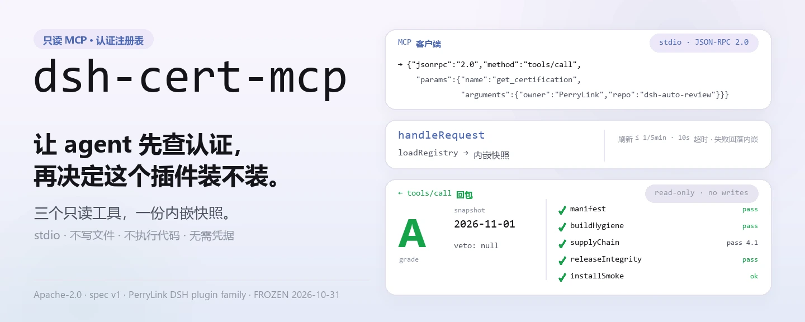
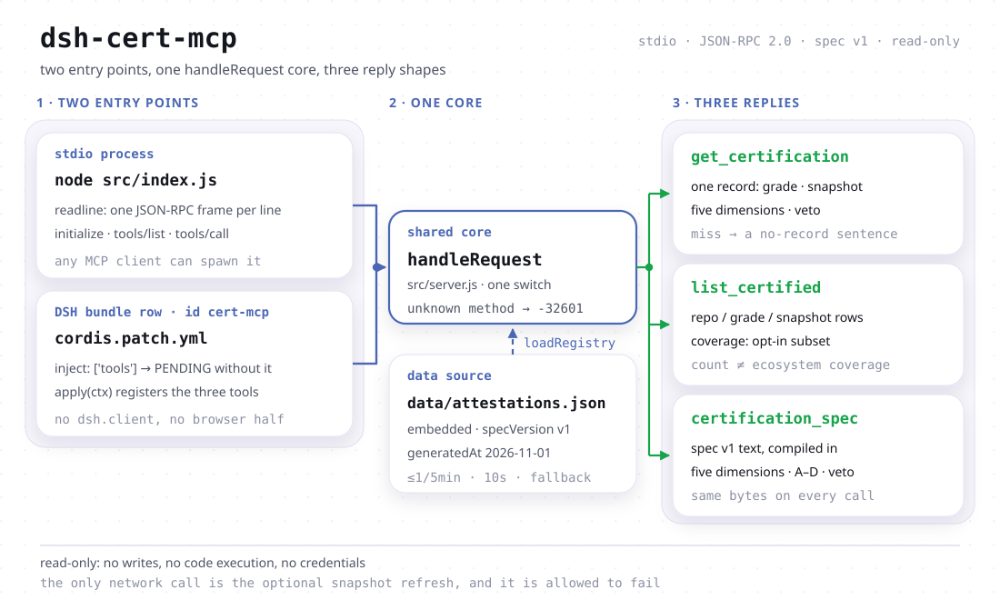

<div align="center">

<picture>
  <source media="(prefers-color-scheme: dark)" srcset="docs/assets/dsh-cert-mcp-hero-zh-dark.webp">
  
</picture>

# dsh-cert-mcp

**一个只读 MCP 端点：把 DSH 插件的认证等级、快照日期与五维证据交给 agent。**

推荐或安装某个插件之前，agent 可以先查它的认证记录——等级、测量日期、五个维度各自的结果、有没有触发否决。三件只读工具、一份内嵌快照、stdio 传输；不写文件、不执行代码、不需要凭据。

[安装](#三步上手) · [工具](#核心能力) · [注册表](#数据与覆盖度) · [FAQ](#faq) · [简体中文](README.md) · [English](README.en.md) · [Español](README.es.md) · [Português](README.pt.md) · [हिन्दी](README.hi.md)

[](LICENSE)
[](#兼容性)
[](https://www.npmjs.com/package/dsh-cert-mcp)
[](https://github.com/PerryLink/dsh-cert-mcp/actions/workflows/smoke.yml)
[](#兼容性)

[](https://github.com/PerryLink/dsh-cert-mcp/stargazers)
[](https://www.npmjs.com/package/dsh-cert-mcp)
[](https://dshfind.com/zh/plugins/PerryLink/dsh-cert-mcp?ref=badge)
[](https://dsh.market/)
[](https://gitee.com/perrylink/dsh-cert-mcp)

```sh
dsh plugin --profile <name> add dsh-cert-mcp
```

</div>

<sub>社区插件，与 DeepSeek 官方无关。唯一仓库：<https://github.com/PerryLink/dsh-cert-mcp>（Gitee 为镜像）。维护状态：🧊 FROZEN，2026-10-31 起冻结，仅作参考集成。</sub>

## 它是什么

只读 MCP server：把 `dsh-plugin-certification` 的注册表暴露成 agent 可以直接调用的三件工具——单条记录的等级、快照日期与五维证据；整个注册表的条目清单与覆盖度说明；以及规范 v1 本身。零运行时依赖，stdin/stdout 上的换行分隔 JSON-RPC，任何支持 stdio 的 MCP 客户端都能拉起它。同一个 `handleRequest` 核也被 DSH bundle 半边复用，所以装成 bundle 之后，这三个工具直接出现在 DSH 工具面上。

它刻意不做的事：不写文件、不执行代码、不需要凭据，也不判断某个插件“该不该装”。查不到记录**不等于**该插件未认证（注册表是自愿加入的子集），一个 A 级**不等于**安全保证（等级是证据记录；插件以你的权限跑在你自己的 DSH 进程里）。

<picture>
  <source media="(prefers-color-scheme: dark)" srcset="docs/assets/dsh-cert-mcp-flow-v5-dark.svg">
  
</picture>

## 三步上手

### 1. 安装（三选一）

```sh
dsh plugin --profile web add dsh-cert-mcp                   # npm 通道（已发布版本）
dsh plugin --profile web add github:PerryLink/dsh-cert-mcp  # git 通道（main 最新）
npx dsh-cert-mcp                                            # 或免安装，直接当 stdio server 跑
```

本包声明了 `dsh.bundle.patch` → `cordis.patch.yml`，插进 profile 的是一行 `id: cert-mcp` 的 bundle row；也可以只当 MCP server 用：`node src/index.js` 或 `npx dsh-cert-mcp`。两种用法互不启动对方（见“两个半边”）。

### 2. 在 MCP 客户端里注册

Claude Code：

```sh
claude mcp add dsh-cert -- node <path-to-repo>/src/index.js
```

Claude Desktop（`claude_desktop_config.json`）：

```json
{
  "mcpServers": {
    "dsh-cert": {
      "command": "node",
      "args": ["<path-to-repo>/src/index.js"]
    }
  }
}
```

DSH 侧：用 [dsh-mcp-panel](https://github.com/PerryLink/dsh-mcp-panel) 以 stdio 服务器方式添加，或者直接安装上面的 bundle。

### 3. 验证

```sh
printf '%s\n' '{"jsonrpc":"2.0","id":1,"method":"initialize","params":{}}' | node src/index.js
```

应看到一行回答：

```text
{"jsonrpc":"2.0","id":1,"result":{"protocolVersion":"2024-11-05","capabilities":{"tools":{}},"serverInfo":{"name":"dsh-cert-mcp","version":"0.2.13"}}}
```

再发 `tools/list` 应看到三件工具。

*实测自 `src/server.js:165-176`（initialize 应答）与 `src/index.js:9-23`（stdio 逐行读取）；版本号取自 `package.json`。*

## 核心能力

### 三件工具

| 工具 | 入参 | 返回 | 用来做什么 |
|---|---|---|---|
| `get_certification` | `owner`、`repo`（大小写不敏感） | 整条记录 JSON：`grade`、`snapshot`、`specVersion`、五个维度、`veto`、`notes`、`selfAssessed`、`assessor` | 已经知道是哪个插件，要它的等级，或等级背后的证据 |
| `list_certified` | 无 | `specVersion`、`generatedAt`、`count`、`coverage`、`entries[]`（repo / grade / snapshot） | 想知道注册表里都有谁，或跨插件比较 |
| `certification_spec` | 无 | 规范 v1 全文：五个维度 A–E、等级刻度、否决规则、证据纪律 | 读到一个等级，想知道它到底意味着什么 |

三件工具都声明了 MCP 只读注解（`readOnlyHint: true` / `destructiveHint: false` / `idempotentHint: true` / `openWorldHint: false`），同样的参数重复调用返回同一条记录。每次 `tools/call` 先过 `loadRegistry`：命中五分钟内的刷新窗口就直接用当前快照，否则尝试拉一次公开注册表，最多等十秒，失败就保留内嵌快照。

### 两个半边，同一条数据路径

bundle row 与 stdio 服务器是同一份 `handleRequest` 核心的两个入口：

- **server 半边**（`src/index.js`，bin 名 `dsh-cert-mcp`）是独立进程，任何 MCP 客户端都能拉起。它**不在插件路径上**：安装 bundle 不会启动它，卸载 bundle 也不会碰它。
- **bundle 半边**（`src/plugin.js`）由 `cordis.patch.yml` 里那一行加载，声明 `inject = ['tools']`，把三件工具挂到 DSH 工具面上。反过来，`npx dsh-cert-mcp` 不会在 DSH 工具面上注册任何东西。

```js
// src/plugin.js — the contract the patch row loads
export const name = 'dsh-cert-mcp'
export const inject = ['tools'] // the host tool surface, provided by dsh-tools
export function apply(ctx) {
  // registers the three read-only tools on ctx.tools, 1:1
}
```

`tools` 是硬依赖：缺少该服务的 profile 不会静默丢工具，Cordis 会把这行停在 `PENDING`，在 profile 的插件列表里看得见。除此之外没有配置键、没有凭据，加载期也不联网。本包不含浏览器 UI，因此没有 `dsh.client` 声明。

### 示例：真实调用

#### 详细示例

**调用**

~~~text
get_certification
~~~

**入参**

~~~json
{ "owner": "PerryLink", "repo": "dsh-auto-review" }
~~~

**返回**（`dimensions.*.evidence` 因长度省略为 `…`，其余字段逐字来自快照）

```json
{
  "repo": "PerryLink/dsh-auto-review",
  "grade": "A",
  "specVersion": "v1",
  "snapshot": "2026-11-01",
  "dimensions": {
    "manifest": { "result": "pass", "evidence": "…" },
    "buildHygiene": { "result": "pass", "evidence": "…" },
    "supplyChain": { "result": "pass", "score": 4.1, "evidence": "…" },
    "releaseIntegrity": { "result": "pass", "evidence": "…" },
    "installSmoke": { "result": "ok", "evidence": "…" }
  },
  "veto": null,
  "notes": "Re-audited at 0.15.0 on 2026-11-01; grade A retained. … Self-assessed: the certifier and the plugin author are the same maintainer …",
  "selfAssessed": true,
  "assessor": "PerryLink (maintainer; same party as the plugin author)"
}
```

*实测自 `src/server.js:192-199`；数据来自 `data/attestations.json`。*

#### 失败分支

**入参**

~~~text
{"owner":"nobody","repo":"nothing"}
~~~

**返回**

~~~text
No certification record for nobody/nothing in registry snapshot 2026-11-01.
~~~

*实测自 `src/server.js:191-199`；查不到就明确说查不到，不猜等级。*

#### 简短示例

- `list_certified` → `count: 1`、`coverage.certified: 1`，并附带“注册表只列被评估过的仓，不是普查”这句说明
- `certification_spec` → 规范 v1 全文（五维 A–E、等级 A–D、否决规则、证据纪律）

## 数据与覆盖度

注册表是 `dsh-plugin-certification` 的**自愿加入子集**：一个仓只有被评估过并留下记录，才会出现在里面。所以有四个推论：

- **查不到 ≠ 未认证。** 记录不存在只说明注册表里没有它，不说明它没被评估过，更不说明它有问题。
- **条数 ≠ 生态覆盖率。** `list_certified` 只返回很少几行，不代表被评估的插件很少；注册表不记录候选总数，所以这里刻意不给任何“N / M”式的分母——那会是编的。
- **单条列表没有统计意义。** 随包快照此刻只有 1 条（`PerryLink/dsh-auto-review`，grade A，快照 2026-11-01，且 `selfAssessed: true`——评估者与插件作者是同一维护者，不是独立第三方认证）；一个等级只描述那一个仓，跨插件可排序的比较要等注册表积累起来。
- **快照日期是认证仓的事实。** `data/attestations.json` 与 `dsh-plugin-certification` 逐字节同步（`schema: dsh-attestation-registry/1`、`specVersion: v1`），刷新节奏与门禁都由那边负责；本 server 只负责搬运。

每一次 `list_certified` 回复都带一个 `coverage` 对象（`certified` / `subset` / `scope` / `representative` / `registry` / `generatedAt`），把上面几条随数值一起发出去，因此只看工具输出的 agent 不会把条数误当成生态覆盖率。

## FAQ

**为什么我在注册表里找不到某个插件？**

注册表是自愿加入的子集，只列被评估过并留下记录的仓；不在里面不构成“未认证”的结论。进注册表的评估流程在 `dsh-plugin-certification`，不在本仓。

**这个仓还会加新功能吗？**

不会。2026-10-31 起冻结，只作参考集成；注册表与评估规则归 `dsh-plugin-certification` 所有。

**要联网吗？要凭据吗？**

都不要凭据。唯一出网动作是快照刷新（最多每五分钟一次、超时十秒），失败就继续用内嵌快照。`initialize` 与 `tools/list` 完全不联网；三件工具都会经过 `loadRegistry`，刷新窗口内同样不出网。

**bundle 和 stdio server 要都装吗？**

不用。两者独立：装 bundle 只影响 DSH 工具面，stdio server 只服务 MCP 客户端；同一个核，互不启动。

**grade A 就代表安全吗？**

不代表。等级是证据记录（清单、构建卫生、供应链 Scorecard、发布溯源、沙箱安装冒烟），不是安全保证；插件以你的权限跑在你自己的进程里。

**刷新之后快照日期会变吗？**

会跟着公开注册表变。这个日期是认证仓的事实，不是本 server 的时效承诺。

## 已知限制

- **冻结在 2026-10-31。** 不再新增认证功能，也不接受把本仓当注册表源的改动。
- **随包快照只有 1 条记录。** `list_certified` 的排序与比较能力此刻没有可比较的对象。
- **没有写入面。** 不能提交认证、不能触发重新评估、不能改快照；要更新只能等上游。
- **刷新是尽力而为。** 命中缓存就不出网，超时或失败静默回落内嵌快照，日志里没有额外提示。
- **协议版本固定在 `2024-11-05`**，能力只声明 `tools`，不支持 resources / prompts。
- **不做鉴权。** 能运行这个进程的人就能读注册表（数据本身是公开的）。
- **等级不含实时安全扫描。** `veto` 只在认证仓判定后出现，本 server 不重新判定。

## 兼容性

| 方面 | 状态 |
|---|---|
| Harness | `engines.dsh`：`>=0.2.1-0 <0.3.0 \|\| >=0.2.2-0 <0.3.0`；开发与测试跑在 `@deepseek-ai/dsh-system-prompt` / `@deepseek-ai/dsh-tools` 0.2.2-rc.1 上 |
| Node | `^22.19.0 \|\| >=24.9.0`（`package.json` 的 `engines.node`） |
| peer | `@deepseek-ai/cordis` `^4.0.2`。bundle 半边运行时还需要 `tools` 服务；stdio 半边除 Node 外什么都不需要。 |
| MCP | 协议版本 `2024-11-05`，只声明 `tools` 能力，stdio 传输 |
| 运行时依赖 | 无——`package.json` 里没有 `dependencies` 字段 |

## 开发

```sh
pnpm install
pnpm run typecheck     # 唯一类型尺子：对已发布 host 面做 checkJs
pnpm test              # JSON-RPC 冒烟 + 真 Cordis 运行时套件
pnpm run check:readmes # 五语 README 同步门
pnpm pack
```

运行时套件挂载**真实**的 `SystemPrompt` / `ToolRuntime` 注册表，断言：挂载本包会把三件认证工具放进 `ctx.tools.schemas()`；释放 fiber 后它们消失；缺少 `tools` 服务的上下文会让插件停在 `PENDING`。验收刻意不用 `dsh --dump-config`：在那里，已挂载的 row 与 pending 的 fiber 看起来一模一样。

本仓刻意只有一把类型尺子：`@deepseek-ai/*` 经本仓自己的 `node_modules`（钉住的 devDependencies）解析，且本包不声明 DSH peer，第二份 `tsc` 配置只会是量同一类型宇宙的同一条命令。独立的第二份证据是上面的运行时挂载门。

## 家族与致谢

本项目是 [PerryLink](https://github.com/PerryLink) 维护的 DeepSeek Harness 插件家族成员。完整名单默认折叠，避免每个 README 的首屏被长表淹没。

<details>
<summary>展开全部插件</summary>

| 插件 | 状态 |
|---|---|
| **[dsh-aqua-input-check](https://github.com/PerryLink/dsh-aqua-input-check)** |  |
| **[dsh-archive-check](https://github.com/PerryLink/dsh-archive-check)** |  |
| **[dsh-auto-review](https://github.com/PerryLink/dsh-auto-review)** |  |
| **[dsh-autotier](https://github.com/PerryLink/dsh-autotier)** |  |
| **[dsh-bid-ca-precheck](https://github.com/PerryLink/dsh-bid-ca-precheck)** |  |
| **[dsh-bid-qual-check](https://github.com/PerryLink/dsh-bid-qual-check)** |  |
| **[dsh-cert-mcp](https://github.com/PerryLink/dsh-cert-mcp)** |  |
| **[dsh-checkpoint-rewind](https://github.com/PerryLink/dsh-checkpoint-rewind)** |  |
| **[dsh-click](https://github.com/PerryLink/dsh-click)** |  |
| **[dsh-composer-history](https://github.com/PerryLink/dsh-composer-history)** |  |
| **[dsh-contract-stance](https://github.com/PerryLink/dsh-contract-stance)** |  |
| **[dsh-customs-doc-check](https://github.com/PerryLink/dsh-customs-doc-check)** |  |
| **[dsh-data-quality](https://github.com/PerryLink/dsh-data-quality)** |  |
| **[dsh-demurrage-ledger](https://github.com/PerryLink/dsh-demurrage-ledger)** |  |
| **[dsh-doublecheck](https://github.com/PerryLink/dsh-doublecheck)** |  |
| **[dsh-drill-script-check](https://github.com/PerryLink/dsh-drill-script-check)** |  |
| **[dsh-eia-guide-check](https://github.com/PerryLink/dsh-eia-guide-check)** |  |
| **[dsh-emergency-plan](https://github.com/PerryLink/dsh-emergency-plan)** |  |
| **[dsh-essay-rubric-check](https://github.com/PerryLink/dsh-essay-rubric-check)** |  |
| **[dsh-evidence-check](https://github.com/PerryLink/dsh-evidence-check)** |  |
| **[dsh-export-ctl-check](https://github.com/PerryLink/dsh-export-ctl-check)** |  |
| **[dsh-fast](https://github.com/PerryLink/dsh-fast)** |  |
| **[dsh-fmea-table-check](https://github.com/PerryLink/dsh-fmea-table-check)** |  |
| **[dsh-forecast-penalty](https://github.com/PerryLink/dsh-forecast-penalty)** |  |
| **[dsh-fund-research](https://github.com/PerryLink/dsh-fund-research)** |  |
| **[dsh-github](https://github.com/PerryLink/dsh-github)** |  |
| **[dsh-gongwen-flow-check](https://github.com/PerryLink/dsh-gongwen-flow-check)** |  |
| **[dsh-gongwen-word-check](https://github.com/PerryLink/dsh-gongwen-word-check)** |  |
| **[dsh-guard-plan-qc](https://github.com/PerryLink/dsh-guard-plan-qc)** |  |
| **[dsh-hazchem-check](https://github.com/PerryLink/dsh-hazchem-check)** |  |
| **[dsh-hazplan-check](https://github.com/PerryLink/dsh-hazplan-check)** |  |
| **[dsh-hidden-risk-map](https://github.com/PerryLink/dsh-hidden-risk-map)** |  |
| **[dsh-hs-classify](https://github.com/PerryLink/dsh-hs-classify)** |  |
| **[dsh-icd-rule-check](https://github.com/PerryLink/dsh-icd-rule-check)** |  |
| **[dsh-industry-research](https://github.com/PerryLink/dsh-industry-research)** |  |
| **[dsh-lawcite-adapter](https://github.com/PerryLink/dsh-lawcite-adapter)** |  |
| **[dsh-laya](https://github.com/PerryLink/dsh-laya)** |  |
| **[dsh-lc-doc-check](https://github.com/PerryLink/dsh-lc-doc-check)** |  |
| **[dsh-learning-gap-check](https://github.com/PerryLink/dsh-learning-gap-check)** |  |
| **[dsh-library](https://github.com/PerryLink/dsh-library)** |  |
| **[dsh-local-ai](https://github.com/PerryLink/dsh-local-ai)** |  |
| **[dsh-lsp-actions](https://github.com/PerryLink/dsh-lsp-actions)** |  |
| **[dsh-mask](https://github.com/PerryLink/dsh-mask)** |  |
| **[dsh-mcp-panel](https://github.com/PerryLink/dsh-mcp-panel)** |  |
| **[dsh-medrec-qc](https://github.com/PerryLink/dsh-medrec-qc)** |  |
| **[dsh-memento](https://github.com/PerryLink/dsh-memento)** |  |
| **[dsh-nsfc-form-check](https://github.com/PerryLink/dsh-nsfc-form-check)** |  |
| **[dsh-nurse-record-check](https://github.com/PerryLink/dsh-nurse-record-check)** |  |
| **[dsh-observe](https://github.com/PerryLink/dsh-observe)** |  |
| **[dsh-origin-rvc-check](https://github.com/PerryLink/dsh-origin-rvc-check)** |  |
| **[dsh-ota-review-check](https://github.com/PerryLink/dsh-ota-review-check)** |  |
| **[dsh-output-styles](https://github.com/PerryLink/dsh-output-styles)** |  |
| **[dsh-paper-doc-adapter](https://github.com/PerryLink/dsh-paper-doc-adapter)** |  |
| **[dsh-permission-rules](https://github.com/PerryLink/dsh-permission-rules)** |  |
| **[dsh-permit-report-check](https://github.com/PerryLink/dsh-permit-report-check)** |  |
| **[dsh-pipeline-check](https://github.com/PerryLink/dsh-pipeline-check)** |  |
| **[dsh-pleading-draft](https://github.com/PerryLink/dsh-pleading-draft)** |  |
| **[dsh-plugin-doctor](https://github.com/PerryLink/dsh-plugin-doctor)** |  |
| **[dsh-plugin-guide](https://github.com/PerryLink/dsh-plugin-guide)** |  |
| **[dsh-plugin-kit](https://github.com/PerryLink/dsh-plugin-kit)** |  |
| **[dsh-plugin-upgrade](https://github.com/PerryLink/dsh-plugin-upgrade)** |  |
| **[dsh-policy-brief-draft](https://github.com/PerryLink/dsh-policy-brief-draft)** |  |
| **[dsh-power-loss-split](https://github.com/PerryLink/dsh-power-loss-split)** |  |
| **[dsh-power-ticket-check](https://github.com/PerryLink/dsh-power-ticket-check)** |  |
| **[dsh-ppap-check](https://github.com/PerryLink/dsh-ppap-check)** |  |
| **[dsh-protest-deadline](https://github.com/PerryLink/dsh-protest-deadline)** |  |
| **[dsh-railway-window](https://github.com/PerryLink/dsh-railway-window)** |  |
| **[dsh-repair-order-qc](https://github.com/PerryLink/dsh-repair-order-qc)** |  |
| **[dsh-research-report](https://github.com/PerryLink/dsh-research-report)** |  |
| **[dsh-review-reply-check](https://github.com/PerryLink/dsh-review-reply-check)** |  |
| **[dsh-rulefile-check](https://github.com/PerryLink/dsh-rulefile-check)** |  |
| **[dsh-safety-brief-check](https://github.com/PerryLink/dsh-safety-brief-check)** |  |
| **[dsh-score](https://github.com/PerryLink/dsh-score)** |  |
| **[dsh-session-sync](https://github.com/PerryLink/dsh-session-sync)** |  |
| **[dsh-site-log-check](https://github.com/PerryLink/dsh-site-log-check)** |  |
| **[dsh-skill-pack-security](https://github.com/PerryLink/dsh-skill-pack-security)** |  |
| **[dsh-soe-decision-check](https://github.com/PerryLink/dsh-soe-decision-check)** |  |
| **[dsh-soilwater-check](https://github.com/PerryLink/dsh-soilwater-check)** |  |
| **[dsh-sop-sync-check](https://github.com/PerryLink/dsh-sop-sync-check)** |  |
| **[dsh-spc-gbt-adapter](https://github.com/PerryLink/dsh-spc-gbt-adapter)** |  |
| **[dsh-talk](https://github.com/PerryLink/dsh-talk)** |  |
| **[dsh-tender-extract](https://github.com/PerryLink/dsh-tender-extract)** |  |
| **[dsh-tender-matrix](https://github.com/PerryLink/dsh-tender-matrix)** |  |
| **[dsh-test-drive](https://github.com/PerryLink/dsh-test-drive)** |  |
| **[dsh-ticktick](https://github.com/PerryLink/dsh-ticktick)** |  |
| **[dsh-translate](https://github.com/PerryLink/dsh-translate)** |  |
| **[dsh-warranty-calc](https://github.com/PerryLink/dsh-warranty-calc)** |  |
| **[dsh-budget](https://github.com/PerryLink/dsh-budget)** | 🧊 已冻结 — 见仓库 README |
| **[dsh-claude-move](https://github.com/PerryLink/dsh-claude-move)** | 🧊 已冻结 — 见仓库 README |
| **[dsh-defend](https://github.com/PerryLink/dsh-defend)** | 🧊 已冻结 — 见仓库 README |
| **[dsh-draw](https://github.com/PerryLink/dsh-draw)** | 🧊 已冻结 — 见仓库 README |
| **[dsh-reach](https://github.com/PerryLink/dsh-reach)** | 🧊 已冻结 — 见仓库 README |
| **[dsh-background-agents](https://github.com/PerryLink/dsh-background-agents)** | 🚫 已退役 — 见仓库 README |
| **[dsh-session-pin](https://github.com/PerryLink/dsh-session-pin)** | 🚫 已退役 — 见仓库 README |
| **[dsh-team-rooms](https://github.com/PerryLink/dsh-team-rooms)** | 🚫 已退役 — 见仓库 README |

</details>

致谢：注册表与五维规范由 [dsh-plugin-certification](https://github.com/PerryLink/dsh-plugin-certification) 维护；协议侧见 [Model Context Protocol](https://modelcontextprotocol.io)；DSH 侧的 MCP 管理界面是 [dsh-mcp-panel](https://github.com/PerryLink/dsh-mcp-panel)。

## License

Apache-2.0。列表或等级是证据记录，不是安全保证：插件以你的权限运行在你的 DSH 进程内。
