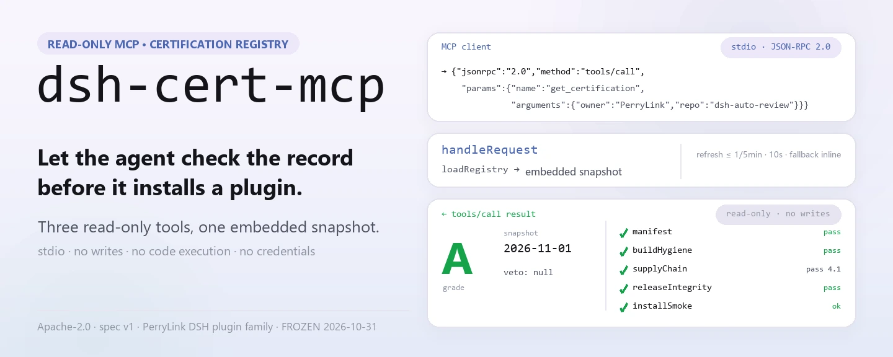
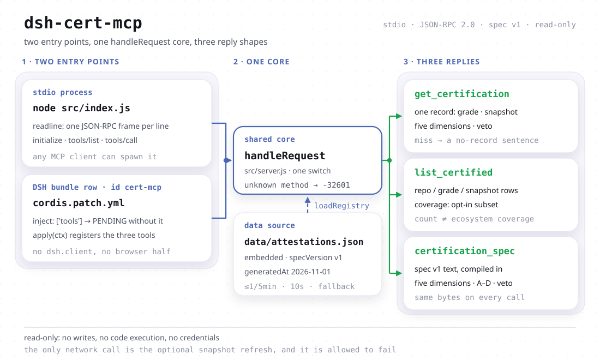

<div align="center">

<picture>
  <source media="(prefers-color-scheme: dark)" srcset="docs/assets/dsh-cert-mcp-hero-en-dark.webp">
  
</picture>

# dsh-cert-mcp

**Um endpoint MCP somente leitura que entrega ao agente os graus de certificação, as datas de snapshot e as evidências em cinco dimensões dos plugins de DSH.**

Antes de recomendar ou instalar um plugin, o agente pode consultar o registro de certificação: o grau, a data em que foi medido, o resultado das cinco dimensões e se houve veto. Três ferramentas somente leitura, um snapshot embutido, transporte stdio — sem escritas, sem execução de código e sem credenciais.

[Instalação](#início-rápido) · [Ferramentas](#capacidades) · [Registro](#dados-e-cobertura) · [FAQ](#faq) · [简体中文](README.md) · [English](README.en.md) · [Español](README.es.md) · [Português](README.pt.md) · [हिन्दी](README.hi.md)

[](LICENSE)
[](#compatibilidade)
[](https://www.npmjs.com/package/dsh-cert-mcp)
[](https://github.com/PerryLink/dsh-cert-mcp/actions/workflows/smoke.yml)
[](#compatibilidade)

[](https://github.com/PerryLink/dsh-cert-mcp/stargazers)
[](https://www.npmjs.com/package/dsh-cert-mcp)
[](https://dshfind.com/pt/plugins/PerryLink/dsh-cert-mcp?ref=badge)
[](https://dsh.market/)
[](https://gitee.com/perrylink/dsh-cert-mcp)

```sh
dsh plugin --profile <name> add dsh-cert-mcp
```

</div>

<sub>Plugin da comunidade, sem vínculo com a DeepSeek. Repositório canônico: <https://github.com/PerryLink/dsh-cert-mcp> (o Gitee é espelho). Estado de manutenção: 🧊 CONGELADO desde 2026-10-31 — apenas integração de referência.</sub>

## O que é

Um servidor MCP somente leitura: expõe o registro de `dsh-plugin-certification` como três ferramentas que o agente pode chamar — o grau, a data de snapshot e a evidência em cinco dimensões de um registro; todas as linhas do registro mais uma declaração de cobertura; e a especificação v1 inteira. Zero dependências de execução e JSON-RPC delimitado por linhas em stdin/stdout, então qualquer cliente MCP com stdio pode iniciá-lo. O mesmo núcleo `handleRequest` é reutilizado pela metade bundle do DSH, então instalar o bundle coloca as três ferramentas direto na superfície de ferramentas do DSH.

O que ele deliberadamente não faz: não escreve, não executa nada, não precisa de credenciais e não decide se um plugin merece ser instalado. Não haver registro **não** significa que o plugin não seja certificado (o registro é um subconjunto opt-in), e um grau A **não** é garantia de segurança (um grau é um registro de evidência; plugins rodam dentro do seu processo DSH com as suas permissões).

<picture>
  <source media="(prefers-color-scheme: dark)" srcset="docs/assets/dsh-cert-mcp-flow-v5-dark.svg">
  
</picture>

## Início rápido

### 1. Instalar (três canais)

```sh
dsh plugin --profile web add dsh-cert-mcp                   # canal npm (publicado)
dsh plugin --profile web add github:PerryLink/dsh-cert-mcp  # canal git (main)
npx dsh-cert-mcp                                            # ou rodar como servidor stdio
```

O pacote declara `dsh.bundle.patch` → `cordis.patch.yml`, então instalá-lo insere uma linha de bundle (`id: cert-mcp`). Também é possível usá-lo como servidor MCP puro: `node src/index.js` ou `npx dsh-cert-mcp`. Nenhum caminho inicia o outro (ver «duas metades»).

### 2. Registrar em um cliente MCP

Claude Code:

```sh
claude mcp add dsh-cert -- node <path-to-repo>/src/index.js
```

Claude Desktop (`claude_desktop_config.json`):

```json
{
  "mcpServers": {
    "dsh-cert": {
      "command": "node",
      "args": ["<path-to-repo>/src/index.js"]
    }
  }
}
```

DSH: adicione com [dsh-mcp-panel](https://github.com/PerryLink/dsh-mcp-panel) como servidor stdio, ou instale o bundle do passo anterior.

### 3. Verificar

```sh
printf '%s\n' '{"jsonrpc":"2.0","id":1,"method":"initialize","params":{}}' | node src/index.js
```

Ele responde com uma linha:

```text
{"jsonrpc":"2.0","id":1,"result":{"protocolVersion":"2024-11-05","capabilities":{"tools":{}},"serverInfo":{"name":"dsh-cert-mcp","version":"0.2.13"}}}
```

Depois, `tools/list` devolve as três ferramentas.

*Observado em `src/server.js:165-176` (resposta ao initialize) e `src/index.js:9-23` (stdio delimitado por linhas); a versão vem do `package.json`.*

## Capacidades

### As três ferramentas

| Ferramenta | Entrada | Retorna | Quando usar |
|---|---|---|---|
| `get_certification` | `owner`, `repo` (sem diferenciar maiúsculas) | o registro completo em JSON: `grade`, `snapshot`, `specVersion`, as cinco dimensões, `veto`, `notes`, `selfAssessed`, `assessor` | você já sabe qual plugin é e quer o grau ou a evidência por trás dele |
| `list_certified` | nenhuma | `specVersion`, `generatedAt`, `count`, `coverage`, `entries[]` (repo / grade / snapshot) | você quer ver o que o registro contém ou comparar plugins |
| `certification_spec` | nenhuma | a especificação v1 inteira: cinco dimensões A–E, escala de graus, regra de veto e disciplina de evidência | você leu um grau e quer saber o que ele significa |

As três declaram as anotações somente leitura do MCP (`readOnlyHint: true` / `destructiveHint: false` / `idempotentHint: true` / `openWorldHint: false`) e chamadas repetidas com os mesmos argumentos devolvem o mesmo registro. Todo `tools/call` passa primeiro por `loadRegistry`: dentro da janela de cinco minutos usa o snapshot atual; caso contrário tenta o registro público uma vez, espera no máximo dez segundos e mantém o snapshot embutido se falhar.

### Duas metades, um só caminho de dados

A linha do bundle e o servidor stdio são duas entradas sobre o mesmo núcleo `handleRequest`:

- **A metade servidor** (`src/index.js`, bin `dsh-cert-mcp`) é um processo independente que qualquer cliente MCP pode iniciar. Ela **não** está no caminho do plugin: instalar o bundle nunca a inicia e remover o bundle nunca a toca.
- **A metade bundle** (`src/plugin.js`) é carregada pela linha em `cordis.patch.yml`, declara `inject = ['tools']` e coloca as três ferramentas na superfície do DSH. Na direção oposta, `npx dsh-cert-mcp` não registra nada nessa superfície.

```js
// src/plugin.js — the contract the patch row loads
export const name = 'dsh-cert-mcp'
export const inject = ['tools'] // the host tool surface, provided by dsh-tools
export function apply(ctx) {
  // registers the three read-only tools on ctx.tools, 1:1
}
```

`tools` é dependência dura: um perfil sem esse serviço não perde as ferramentas em silêncio — o Cordis deixa a linha em `PENDING`, visível na lista de plugins do perfil. Nada mais é necessário: sem chaves de configuração, sem credenciais e sem rede ao carregar. O pacote não inclui interface de navegador, portanto não há declaração `dsh.client`.

### Exemplos: chamadas reais

#### Exemplo detalhado

**Chamada**

~~~text
get_certification
~~~

**Entrada**

~~~json
{ "owner": "PerryLink", "repo": "dsh-auto-review" }
~~~

**Saída**(`dimensions.*.evidence` é encurtado para `…` por largura; os demais campos são literais do snapshot)

```json
{
  "repo": "PerryLink/dsh-auto-review",
  "grade": "A",
  "specVersion": "v1",
  "snapshot": "2026-11-01",
  "dimensions": {
    "manifest": { "result": "pass", "evidence": "…" },
    "buildHygiene": { "result": "pass", "evidence": "…" },
    "supplyChain": { "result": "pass", "score": 4.1, "evidence": "…" },
    "releaseIntegrity": { "result": "pass", "evidence": "…" },
    "installSmoke": { "result": "ok", "evidence": "…" }
  },
  "veto": null,
  "notes": "Re-audited at 0.15.0 on 2026-11-01; grade A retained. … Self-assessed: the certifier and the plugin author are the same maintainer …",
  "selfAssessed": true,
  "assessor": "PerryLink (maintainer; same party as the plugin author)"
}
```

*Observado em `src/server.js:192-199`; dados de `data/attestations.json`.*

#### Ramo de falha

**Entrada**

~~~text
{"owner":"nobody","repo":"nothing"}
~~~

**Saída**

~~~text
No certification record for nobody/nothing in registry snapshot 2026-11-01.
~~~

*Observado em `src/server.js:191-199`; quando não há registro, ele diz isso sem inventar um grau.*

#### Exemplos curtos

- `list_certified` → `count: 1`, `coverage.certified: 1`, mais a frase que explica que o registro lista apenas repositórios avaliados e não é um censo
- `certification_spec` → especificação v1 inteira (cinco dimensões A–E, graus A–D, regra de veto, disciplina de evidência)

## Dados e cobertura

O registro é um **subconjunto opt-in** de `dsh-plugin-certification`: um repositório só aparece depois de ser avaliado e registrado. Quatro consequências:

- **Sem registro ≠ sem certificação.** A ausência de registro só diz que o registro público não o contém; não diz que o plugin nunca foi avaliado nem que haja algo errado com ele.
- **Quantidade ≠ cobertura do ecossistema.** Uma resposta curta de `list_certified` não prova que poucos plugins foram avaliados; o registro não guarda quantos candidatos existem, então aqui não se oferece denominador «N de M» — esse número seria inventado.
- **Uma lista de um item não tem significado estatístico.** O snapshot embutido tem exatamente um registro (`PerryLink/dsh-auto-review`, grau A, snapshot 2026-11-01 e `selfAssessed: true` — quem avalia e o autor do plugin são o mesmo mantenedor, então não é certificação independente). Um grau descreve aquele repositório; comparação ordenável só existe quando o registro cresce.
- **A data do snapshot é um fato do repositório de certificação.** `data/attestations.json` é sincronizado byte a byte de `dsh-plugin-certification` (`schema: dsh-attestation-registry/1`, `specVersion: v1`); aquele repositório é dono do calendário e do portão de qualidade. Este servidor apenas transporta os dados.

Toda resposta de `list_certified` leva um objeto `coverage` (`certified` / `subset` / `scope` / `representative` / `registry` / `generatedAt`) que viaja junto aos números, de modo que um agente que lê apenas a saída não confunda a contagem com cobertura do ecossistema.

## FAQ

**Por que um plugin está faltando no registro?**

O registro é um subconjunto opt-in: lista apenas repositórios avaliados e registrados. A ausência não significa que o plugin não seja certificado. A avaliação vive em `dsh-plugin-certification`, não aqui.

**Este repositório vai ganhar novas funções?**

Não. Foi congelado em 2026-10-31 e permanece como integração de referência; o registro e as regras de avaliação pertencem a `dsh-plugin-certification`.

**Precisa de rede ou credenciais?**

Nenhuma credencial. A única chamada de saída é a atualização do snapshot (no máximo uma vez a cada cinco minutos, com dez segundos de espera) e, se falhar, o snapshot embutido continua. `initialize` e `tools/list` não fazem chamada de rede; as três ferramentas passam por `loadRegistry`, que também não sai para a rede enquanto a janela de atualização está aberta.

**Preciso instalar o bundle e o servidor stdio?**

Não. São independentes: o bundle só afeta a superfície do DSH e o servidor stdio só atende clientes MCP. Mesmo núcleo, nenhum inicia o outro.

**Grau A significa que o plugin é seguro?**

Não. Um grau é registro de evidência (manifesto, higiene de build, Scorecard da cadeia de suprimentos, proveniência da publicação, teste de instalação em sandbox), não garantia de segurança; plugins rodam no seu processo com as suas permissões.

**A data do snapshot muda depois de uma atualização?**

Segue o registro público. Essa data é um fato do repositório de certificação, não uma promessa de atualidade deste servidor.

## Limites conhecidos

- **Congelado em 2026-10-31.** Sem novas funções de certificação e sem mudanças que façam deste repositório a fonte do registro.
- **O snapshot embutido tem um único registro.** Ordenação e comparação em `list_certified` ainda não têm com o que comparar.
- **Sem superfície de escrita.** Não é possível enviar uma certificação, disparar reavaliação nem editar o snapshot; atualizações só vêm de cima.
- **A atualização é best-effort.** Um acerto de cache não sai para a rede e um timeout volta ao snapshot embutido em silêncio, sem linha de log extra.
- **A versão de protocolo é fixa em `2024-11-05`** e a única capacidade declarada é `tools`; sem resources ou prompts.
- **Sem autenticação.** Quem consegue executar o processo consegue ler o registro (os dados já são públicos).
- **Um grau não é uma varredura de segurança ao vivo.** `veto` só aparece se o repositório de certificação registrou; este servidor não julga de novo.

## Compatibilidade

| Superfície | Estado |
|---|---|
| Harness | `engines.dsh`: `>=0.2.1-0 <0.3.0 \|\| >=0.2.2-0 <0.3.0`; o desenvolvimento e os testes rodam contra `@deepseek-ai/dsh-system-prompt` / `@deepseek-ai/dsh-tools` 0.2.2-rc.1 |
| Node | `^22.19.0 \|\| >=24.9.0` (`engines.node` no `package.json`) |
| Peer | `@deepseek-ai/cordis` `^4.0.2`. A metade bundle ainda precisa do serviço `tools` em execução; a metade stdio não precisa de nada além do Node. |
| MCP | Versão de protocolo `2024-11-05`, apenas a capacidade `tools`, transporte stdio |
| Dependências de execução | Nenhuma — o `package.json` não declara `dependencies` |

## Desenvolvimento

```sh
pnpm install
pnpm run typecheck     # a única régua de tipos: checkJs sobre a face publicada
pnpm test              # smoke JSON-RPC + suíte de execução com Cordis real
pnpm run check:readmes # portão de sincronia dos cinco READMEs
pnpm pack
```

A suíte monta os registros REAIS `SystemPrompt` / `ToolRuntime` e verifica que montar este pacote coloca as três ferramentas em `ctx.tools.schemas()`, que liberar o fiber as remove e que um contexto sem o serviço `tools` deixa o plugin em `PENDING`. `dsh --dump-config` não é usado como aceitação: ali uma linha montada e um fiber pendente parecem iguais.

Há deliberadamente uma única régua de tipos: `@deepseek-ai/*` resolve pelo `node_modules` deste repositório (as devDependencies fixadas) e o pacote não declara peer de DSH, então uma segunda configuração de `tsc` seria o mesmo comando sobre o mesmo universo de tipos. A segunda evidência independente é o portão de montagem em execução acima.

## Família e créditos

Este projeto faz parte da família de plugins de DeepSeek Harness de [PerryLink](https://github.com/PerryLink). A lista fica recolhida para que cada README mantenha uma primeira tela curta.

<details>
<summary>Expandir todos os plugins</summary>

| Plugin | Status |
|---|---|
| **[dsh-aqua-input-check](https://github.com/PerryLink/dsh-aqua-input-check)** |  |
| **[dsh-archive-check](https://github.com/PerryLink/dsh-archive-check)** |  |
| **[dsh-auto-review](https://github.com/PerryLink/dsh-auto-review)** |  |
| **[dsh-autotier](https://github.com/PerryLink/dsh-autotier)** |  |
| **[dsh-bid-ca-precheck](https://github.com/PerryLink/dsh-bid-ca-precheck)** |  |
| **[dsh-bid-qual-check](https://github.com/PerryLink/dsh-bid-qual-check)** |  |
| **[dsh-cert-mcp](https://github.com/PerryLink/dsh-cert-mcp)** |  |
| **[dsh-checkpoint-rewind](https://github.com/PerryLink/dsh-checkpoint-rewind)** |  |
| **[dsh-click](https://github.com/PerryLink/dsh-click)** |  |
| **[dsh-composer-history](https://github.com/PerryLink/dsh-composer-history)** |  |
| **[dsh-contract-stance](https://github.com/PerryLink/dsh-contract-stance)** |  |
| **[dsh-customs-doc-check](https://github.com/PerryLink/dsh-customs-doc-check)** |  |
| **[dsh-data-quality](https://github.com/PerryLink/dsh-data-quality)** |  |
| **[dsh-demurrage-ledger](https://github.com/PerryLink/dsh-demurrage-ledger)** |  |
| **[dsh-doublecheck](https://github.com/PerryLink/dsh-doublecheck)** |  |
| **[dsh-drill-script-check](https://github.com/PerryLink/dsh-drill-script-check)** |  |
| **[dsh-eia-guide-check](https://github.com/PerryLink/dsh-eia-guide-check)** |  |
| **[dsh-emergency-plan](https://github.com/PerryLink/dsh-emergency-plan)** |  |
| **[dsh-essay-rubric-check](https://github.com/PerryLink/dsh-essay-rubric-check)** |  |
| **[dsh-evidence-check](https://github.com/PerryLink/dsh-evidence-check)** |  |
| **[dsh-export-ctl-check](https://github.com/PerryLink/dsh-export-ctl-check)** |  |
| **[dsh-fast](https://github.com/PerryLink/dsh-fast)** |  |
| **[dsh-fmea-table-check](https://github.com/PerryLink/dsh-fmea-table-check)** |  |
| **[dsh-forecast-penalty](https://github.com/PerryLink/dsh-forecast-penalty)** |  |
| **[dsh-fund-research](https://github.com/PerryLink/dsh-fund-research)** |  |
| **[dsh-github](https://github.com/PerryLink/dsh-github)** |  |
| **[dsh-gongwen-flow-check](https://github.com/PerryLink/dsh-gongwen-flow-check)** |  |
| **[dsh-gongwen-word-check](https://github.com/PerryLink/dsh-gongwen-word-check)** |  |
| **[dsh-guard-plan-qc](https://github.com/PerryLink/dsh-guard-plan-qc)** |  |
| **[dsh-hazchem-check](https://github.com/PerryLink/dsh-hazchem-check)** |  |
| **[dsh-hazplan-check](https://github.com/PerryLink/dsh-hazplan-check)** |  |
| **[dsh-hidden-risk-map](https://github.com/PerryLink/dsh-hidden-risk-map)** |  |
| **[dsh-hs-classify](https://github.com/PerryLink/dsh-hs-classify)** |  |
| **[dsh-icd-rule-check](https://github.com/PerryLink/dsh-icd-rule-check)** |  |
| **[dsh-industry-research](https://github.com/PerryLink/dsh-industry-research)** |  |
| **[dsh-lawcite-adapter](https://github.com/PerryLink/dsh-lawcite-adapter)** |  |
| **[dsh-laya](https://github.com/PerryLink/dsh-laya)** |  |
| **[dsh-lc-doc-check](https://github.com/PerryLink/dsh-lc-doc-check)** |  |
| **[dsh-learning-gap-check](https://github.com/PerryLink/dsh-learning-gap-check)** |  |
| **[dsh-library](https://github.com/PerryLink/dsh-library)** |  |
| **[dsh-local-ai](https://github.com/PerryLink/dsh-local-ai)** |  |
| **[dsh-lsp-actions](https://github.com/PerryLink/dsh-lsp-actions)** |  |
| **[dsh-mask](https://github.com/PerryLink/dsh-mask)** |  |
| **[dsh-mcp-panel](https://github.com/PerryLink/dsh-mcp-panel)** |  |
| **[dsh-medrec-qc](https://github.com/PerryLink/dsh-medrec-qc)** |  |
| **[dsh-memento](https://github.com/PerryLink/dsh-memento)** |  |
| **[dsh-nsfc-form-check](https://github.com/PerryLink/dsh-nsfc-form-check)** |  |
| **[dsh-nurse-record-check](https://github.com/PerryLink/dsh-nurse-record-check)** |  |
| **[dsh-observe](https://github.com/PerryLink/dsh-observe)** |  |
| **[dsh-origin-rvc-check](https://github.com/PerryLink/dsh-origin-rvc-check)** |  |
| **[dsh-ota-review-check](https://github.com/PerryLink/dsh-ota-review-check)** |  |
| **[dsh-output-styles](https://github.com/PerryLink/dsh-output-styles)** |  |
| **[dsh-paper-doc-adapter](https://github.com/PerryLink/dsh-paper-doc-adapter)** |  |
| **[dsh-permission-rules](https://github.com/PerryLink/dsh-permission-rules)** |  |
| **[dsh-permit-report-check](https://github.com/PerryLink/dsh-permit-report-check)** |  |
| **[dsh-pipeline-check](https://github.com/PerryLink/dsh-pipeline-check)** |  |
| **[dsh-pleading-draft](https://github.com/PerryLink/dsh-pleading-draft)** |  |
| **[dsh-plugin-doctor](https://github.com/PerryLink/dsh-plugin-doctor)** |  |
| **[dsh-plugin-guide](https://github.com/PerryLink/dsh-plugin-guide)** |  |
| **[dsh-plugin-kit](https://github.com/PerryLink/dsh-plugin-kit)** |  |
| **[dsh-plugin-upgrade](https://github.com/PerryLink/dsh-plugin-upgrade)** |  |
| **[dsh-policy-brief-draft](https://github.com/PerryLink/dsh-policy-brief-draft)** |  |
| **[dsh-power-loss-split](https://github.com/PerryLink/dsh-power-loss-split)** |  |
| **[dsh-power-ticket-check](https://github.com/PerryLink/dsh-power-ticket-check)** |  |
| **[dsh-ppap-check](https://github.com/PerryLink/dsh-ppap-check)** |  |
| **[dsh-protest-deadline](https://github.com/PerryLink/dsh-protest-deadline)** |  |
| **[dsh-railway-window](https://github.com/PerryLink/dsh-railway-window)** |  |
| **[dsh-repair-order-qc](https://github.com/PerryLink/dsh-repair-order-qc)** |  |
| **[dsh-research-report](https://github.com/PerryLink/dsh-research-report)** |  |
| **[dsh-review-reply-check](https://github.com/PerryLink/dsh-review-reply-check)** |  |
| **[dsh-rulefile-check](https://github.com/PerryLink/dsh-rulefile-check)** |  |
| **[dsh-safety-brief-check](https://github.com/PerryLink/dsh-safety-brief-check)** |  |
| **[dsh-score](https://github.com/PerryLink/dsh-score)** |  |
| **[dsh-session-sync](https://github.com/PerryLink/dsh-session-sync)** |  |
| **[dsh-site-log-check](https://github.com/PerryLink/dsh-site-log-check)** |  |
| **[dsh-skill-pack-security](https://github.com/PerryLink/dsh-skill-pack-security)** |  |
| **[dsh-soe-decision-check](https://github.com/PerryLink/dsh-soe-decision-check)** |  |
| **[dsh-soilwater-check](https://github.com/PerryLink/dsh-soilwater-check)** |  |
| **[dsh-sop-sync-check](https://github.com/PerryLink/dsh-sop-sync-check)** |  |
| **[dsh-spc-gbt-adapter](https://github.com/PerryLink/dsh-spc-gbt-adapter)** |  |
| **[dsh-talk](https://github.com/PerryLink/dsh-talk)** |  |
| **[dsh-tender-extract](https://github.com/PerryLink/dsh-tender-extract)** |  |
| **[dsh-tender-matrix](https://github.com/PerryLink/dsh-tender-matrix)** |  |
| **[dsh-test-drive](https://github.com/PerryLink/dsh-test-drive)** |  |
| **[dsh-ticktick](https://github.com/PerryLink/dsh-ticktick)** |  |
| **[dsh-translate](https://github.com/PerryLink/dsh-translate)** |  |
| **[dsh-warranty-calc](https://github.com/PerryLink/dsh-warranty-calc)** |  |
| **[dsh-budget](https://github.com/PerryLink/dsh-budget)** | 🧊 CONGELADO — ver o README do repositório |
| **[dsh-claude-move](https://github.com/PerryLink/dsh-claude-move)** | 🧊 CONGELADO — ver o README do repositório |
| **[dsh-defend](https://github.com/PerryLink/dsh-defend)** | 🧊 CONGELADO — ver o README do repositório |
| **[dsh-draw](https://github.com/PerryLink/dsh-draw)** | 🧊 CONGELADO — ver o README do repositório |
| **[dsh-reach](https://github.com/PerryLink/dsh-reach)** | 🧊 CONGELADO — ver o README do repositório |
| **[dsh-background-agents](https://github.com/PerryLink/dsh-background-agents)** | 🚫 RETIRADO — ver o README do repositório |
| **[dsh-session-pin](https://github.com/PerryLink/dsh-session-pin)** | 🚫 RETIRADO — ver o README do repositório |
| **[dsh-team-rooms](https://github.com/PerryLink/dsh-team-rooms)** | 🚫 RETIRADO — ver o README do repositório |

</details>

Créditos: o registro e a especificação de cinco dimensões são mantidos por [dsh-plugin-certification](https://github.com/PerryLink/dsh-plugin-certification); o lado do protocolo é o [Model Context Protocol](https://modelcontextprotocol.io); o console MCP do DSH é o [dsh-mcp-panel](https://github.com/PerryLink/dsh-mcp-panel).

## License

Apache-2.0. Uma listagem ou um grau é registro de evidência, não garantia de segurança: plugins rodam dentro do seu processo DSH com as suas permissões.
